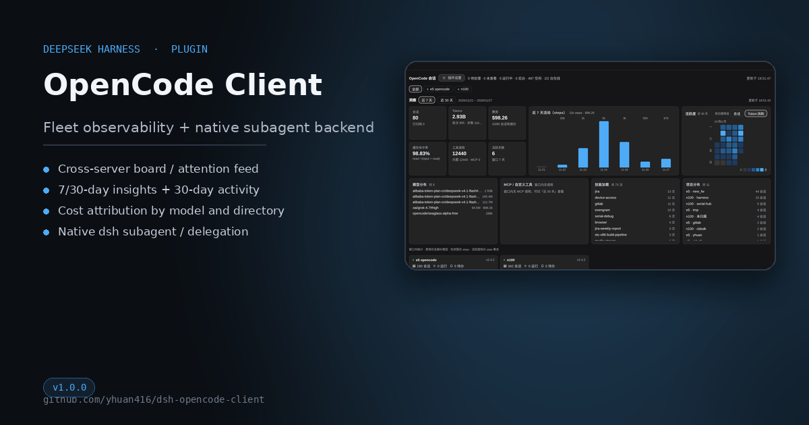
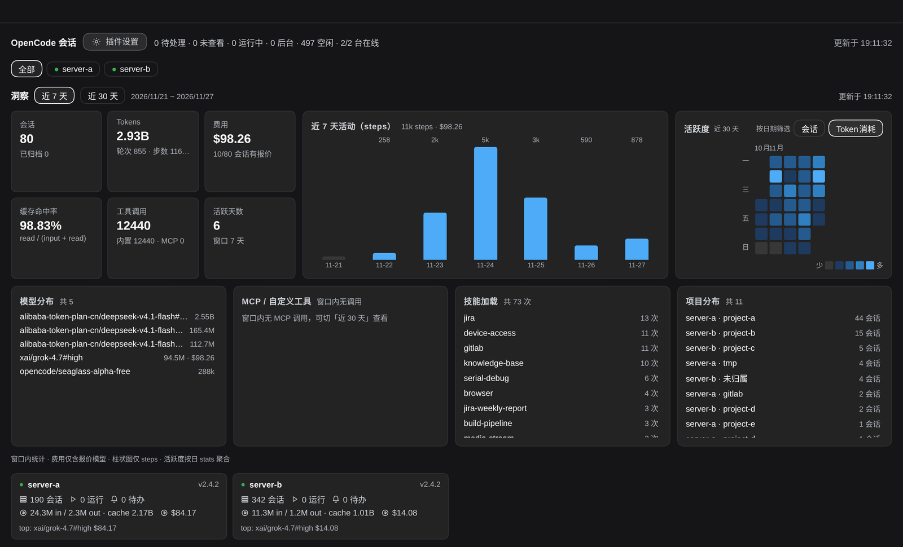
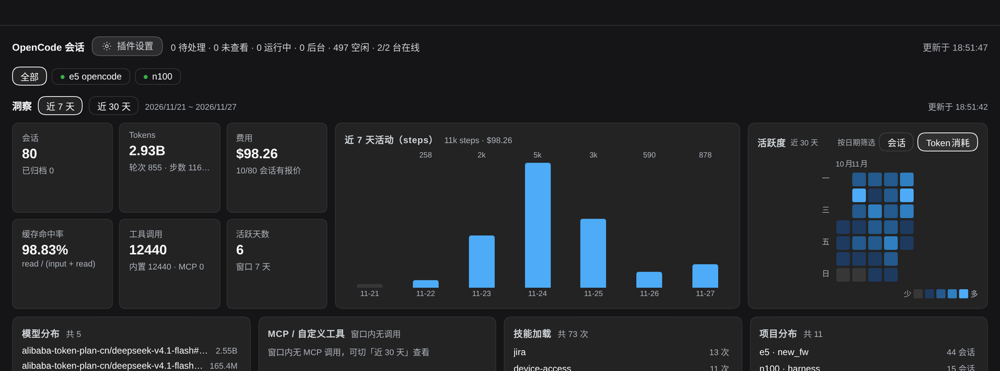
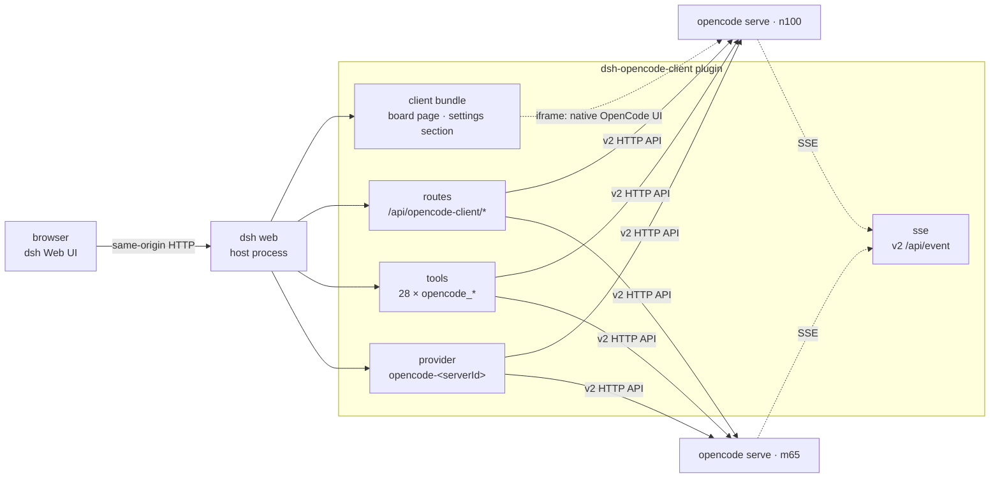

# dsh-opencode-client

<p align="center">
  <a href="https://github.com/yhuan416/dsh-opencode-client/releases"></a>
  <a href="LICENSE"></a>
  
  
  
  <a href="https://github.com/yhuan416/dsh-opencode-client/actions/workflows/check.yml"></a>
</p>

<p align="center">
  <a href="docs/assets/cover.png"></a>
</p>

> English | [中文](README.zh.md)

**An observation console for a fleet of OpenCode servers, plus a native dsh subagent backend.**
The plugin connects to one or more remote `opencode serve` instances and answers three questions
OpenCode's own clients cannot: which sessions are running across *all* servers, which are waiting
for you, and what failed — then delegates work into them and registers each server as a native
dsh subagent provider (`opencode-<serverId>`).

> **Positioning (0.6.0)**: session access is a means, not the goal. Chatting inside a session
> belongs to OpenCode's TUI/Web (we deep-link into it); this plugin owns the cross-server board,
> the attention feed, and the agent-facing backend.
>
> **Two tracks, one core (2026-11-27)**: `[observe]` — the human-facing console (board, attention,
> cost governance) — is the current priority and is being finished first; `[delegate]` — the
> agent-facing tools and native subagent provider — follows in later releases. Both share one
> transport and version-probing core. See `TODO.md` §10 for the per-track roadmap.

**Compatibility**: **OpenCode 2.x only** (`/api/*` + HTTP Basic auth). The v1 API (OpenCode
1.18.x) was frozen in 0.7.2 and removed in **1.0.0** — a v1 server now fails with a clear
"requires OpenCode 2.x" error. `apiVersion: auto|2` is accepted;
`auto` probes `GET /api/info` and records why a probe failed.
See [Compatibility & versioning](#compatibility--versioning).

> **Primary role**: register OpenCode as a native dsh subagent backend
> (`opencode_subagent_<server>`) and expose remote sessions/workspaces as tools
> (`opencode_subagent`, `opencode_prompt`, shell/git/read/find, catalogs). The embedded OpenCode
> Web UI is an optional convenience for full-fidelity work, not a replacement for the OpenCode
> client.

## Screenshots

**Board** — one page across every server: attention, 7/30-day insights, a 30-day activity
calendar, and the idle fleet below.



**Insights** — cards, daily steps and the activity heatmap share one top row.



## Table of contents

- [Screenshots](#screenshots) · [Quick start](#quick-start) · [Architecture](#architecture) · [Features](#features)
- [Install (profile)](#install-profile) · [Configuration](#configuration) · [Subagent seam](#subagent-seam)
- [Documentation](#documentation) · [Ecosystem](#ecosystem) · [Compatibility & versioning](#compatibility--versioning) · [Notes](#notes)

## Quick start

```sh
# 1. install the plugin into the web profile (bundle selection is composed at restart)
#    a local checkout works too: dsh plugin --profile web add /path/to/dsh-opencode-client
dsh plugin --profile web add dsh-opencode-client

# 2. configure at least one server (full schema in Configuration)
#    OpenCode 2.x also needs the server password:
#    config.servers: [{ id: n100, url: "http://192.168.4.50:4096", password: "<OPENCODE_SERVER_PASSWORD>" }]

# 3. restart dsh web
dsh web
```

Verify:

1. **Settings → Plugins → OpenCode Client** shows the server / workspace / session section
   (`GET /api/opencode-client/list` answers with the configured servers).
2. Ask the agent to call **`opencode_sessions`** — it lists remote sessions, so the HTTP path to
   `opencode serve` works end to end.
3. Optional: expose the server as a native subagent (`opencode_subagent_<server>`) — see
   [Subagent seam](#subagent-seam).

Full live acceptance run (needs a real OpenCode 2 `opencode serve`):

```sh
OPC_LIVE_URL=http://192.168.4.50:4096 \
OPC_LIVE_PASSWORD='<OPENCODE_SERVER_PASSWORD>' \
OPC_LIVE_DIR=/home/yhuan/workspace \
node scripts/e2e-live.mjs        # or: npm run e2e; OPC_LIVE_INTERACTIONS=1 also exercises approval/question bridging
```

`OPC_LIVE_PASSWORD` is required (OpenCode 2 always uses HTTP Basic auth). Offline checks:
`npm test` (unit + transport tests) or `npm run check` (smoke checks + tests).

Prerequisite: `opencode serve` must be reachable from the dsh host. It binds `127.0.0.1` by
default — bind `0.0.0.0` or put it behind an SSH tunnel. **OpenCode 2 always requires
`OPENCODE_SERVER_PASSWORD` on the serve process plus the same value in the plugin's server
`password`**.

## Architecture

OpenCode's own architecture: `opencode serve` exposes an OpenAPI HTTP server "that an opencode
client can use"; the TUI / Web / SDK are clients of it. This plugin is another client, hosted in
dsh.



The browser only talks to the **dsh origin** — `lib/client.js` renders the board/plugin page and
embeds the native OpenCode UI in an iframe when a session is opened. `lib/routes.js`
(`/api/opencode-client/*`) and the model-facing `opencode_*` tools (`lib/tools.js`) make
deterministic calls through `@opencode/client` (pinned `2.4.2`, one client per server);
`lib/provider.js` (`opencode-<serverId>`) and `lib/session-run.js` drive delegated runs;
`lib/sse.js` subscribes to each server's `/api/event` stream with Basic auth and reconnect for
live progress, completion and permission/question bridging. `lib/http.js` probes
`GET /api/info` once per server, adds HTTP Basic auth and rejects v1 with an actionable error;
`lib/oc-client.js` owns the client instance and error mapping.

More: [ARCHITECTURE.md](ARCHITECTURE.md) · [docs/ARCHITECTURE.zh.md](docs/ARCHITECTURE.zh.md).

## Features

28 model-facing `opencode_*` tools, host routes, one native subagent provider per server — the
same tool names. **OpenCode 2 is the only supported generation**: v1 was frozen in 0.7.2 and
removed in **1.0.0**; a v1 server is rejected at the transport with an actionable error ([policy](COMPATIBILITY.md#v1-policy-removed)).

### OpenCode 2 API notes

OpenCode 2 removed a few v1 endpoints. Two capabilities now return an explicit "not available on
OpenCode 2" message instead of empty data, two are restored with v2-native calls, and two are
v2-only:

| Capability | OpenCode 2 behaviour |
|---|---|
| `opencode_share` | **not available** (no share endpoint) |
| `opencode_tools` | **not available** (no tool-ids endpoint) |
| `opencode_find` with `kind=text` | **restored via fallback**: no content-search endpoint, so the plugin runs a workspace `grep` through the async shell (literal substring, first 100 matches) |
| todo list in `opencode_session_info` | **restored via fallback**: `/session/{id}/todo` was removed, so todos are derived from the last `todowrite` tool call |
| `opencode_usage` | **OpenCode 2 only**: `GET /experimental/session/stats` aggregates sessions/steps/tokens/cost/tool success rate, plus per-model attribution and (host route `?group=directory`) per-directory cost |
| background jobs (board/progress) | **OpenCode 2 only, experimental**: `GET /experimental/job` lists work that outlives the turn (e.g. a shell script still running after the session went idle); shown as the `background` status |

On OpenCode 2 the plugin also normalizes these API differences for you:

- Sessions carry `location.directory`; session/message/diff results are normalized to one shape.
- Prompts are `{text, files}`; `agent` and `model` are session state
  (`POST /api/session/{id}/agent|model`).
- Completion is detected from `session.execution.succeeded|failed|interrupted` events.
- Permission approvals use `once|always|reject`; questions arrive as forms with typed fields
  (string / number / integer / boolean / multiselect).
- `opencode_shell` runs asynchronously in the session workspace (submit, poll, read output); output
  pages are followed via cursor (up to 1 MiB) and truncation is reported explicitly with exit/signal.
- `opencode_summarize` maps to `compact` (the session's own model is used, so `model` is optional);
  `opencode_init` runs the built-in `init` command; `opencode_git_diff` maps `git` → `working`;
  `opencode_find` retries a glob query as a plain substring (the endpoint does not understand
  `*`/`?`).

### Subagent delegation

- **Native subagent** — provider `opencode-<serverId>`; pair with `@deepseek-ai/dsh-tool-subagent`
  to expose one-shot `opencode_subagent_<server>` tools.
- **Delegation** — tool `opencode_subagent` (new session, or continue with `session=`; optional
  `agent`, `model` and prompt-enforced `schema`); uses `session.prompt` + message polling with a
  blocking wait, and returns the final answer plus the session id. The prompt is `{text, files}`
  and `agent`/`model` are applied as session state.
- **Turn-by-turn continuation** — `opencode_prompt` sends one message to an existing remote session
  (fire-and-forget by default, `wait=true` to block); read the reply with
  `opencode_messages`/`opencode_progress` and send the next message. This keeps a remote worker
  session alive across dsh turns.
- **Completion wait** — `prompt_async` + SSE event-driven (returns immediately when the remote
  finishes), 5 s polling fallback, then a blocking wait. Completion is detected from
  `session.execution.succeeded|failed|interrupted`.
- **Live progress** — `opencode_progress` (current tool/step, elapsed, output tail) fed by SSE
  tool events; delegation completes on the SSE completion event.
- **Abort** — `opencode_abort` stops a running remote session (`session.interrupt`); a
  waiting delegation returns an abort error instead of hanging. Call it from another dsh
  session/agent: tool calls inside one turn are serialized, so it cannot preempt a blocking
  `opencode_subagent` in the same turn.
- **Attachments** — `opencode_subagent` accepts a `files` JSON array (text/base64 → data URL);
  attachments are sent as `{uri, name}`.

### Sessions & messages

- **Server configuration** — `servers: [{ id, label?, url, password?, directory? }]`, with optional
  per-server default `agent` and `model`.
- **Discovery** — `GET /api/opencode-client/list` (server health, projects, sessions grouped by
  directory; the directory comes from `location.directory`).
- **Session listing** — tool `opencode_sessions` + `GET /api/opencode-client/sessions`; rows include
  the model (with `#variant`), agent, outcome and cost when the server reports them. `archived=true`
  lists archived sessions, and `cursor`/`nextCursor` page past the first 500-row snapshot.
- **Session messages** — tool `opencode_messages` + `GET /api/opencode-client/messages` (text, tool
  and file parts; `content[]` text/reasoning/tool parts are normalized). Tool lines include the
  call input summary and the first output line; `type=` filters one message kind (server-side).
  Useful to decide whether a session is the right one to continue.
- **Session info** — tool `opencode_session_info` (title/summary/todos/diff; the todo list is derived from the last `todowrite` call, and
  outcome/cost/tokens plus the changed-file diff are reported) and `opencode_share` (share/unshare
  link; not available on OpenCode 2 and the tool says so).
- **Session management** — `opencode_fork`, `opencode_children`, `opencode_summarize` (mutating;
  v2 maps it to `compact`, where the session's own model is used and `model` is optional),
  `opencode_init` (writes AGENTS.md, requires `confirm=true`; runs the built-in `init` command).
- **Session search & diagnostics** — `opencode_search` (session search through the list endpoint's
  `search` filter), `opencode_mcp` (MCP server status).
- **Multiple servers** — configured as an array and aggregated by the client (opencode itself has
  no server-side federation).

### Catalogs & tool discovery

- **Agent catalog** — tool `opencode_agents` + `GET /api/opencode-client/agents`
  (primary/subagent, native/custom); call it before `opencode_subagent` to pick an agent name.
- **Catalogs** — `opencode_models` (providers/models, credentials stripped), `opencode_commands`,
  `opencode_skills`, `opencode_tools` (not available on OpenCode 2; no tool-ids endpoint),
  `opencode_references`.
- **Command execution** — `opencode_command` runs a remote command (e.g. `init`) inside a session
  and returns its final text.

### Workspace & git

- **Workspace ops** — `opencode_shell`, `opencode_git_status`, `opencode_git_diff`,
  `opencode_read_file`, `opencode_find` (`kind=file` searches paths, `kind=dir` directories;
  `kind=text` runs a workspace grep fallback).
- These are deterministic direct calls (no remote model involved): verify what a remote agent
  changed, read a file, run a command, or search the workspace.
- `opencode_shell` is asynchronous (submit, poll, read output) in the session workspace;
  `opencode_git_diff` accepts `committed`/`branch`/`working` (with `git` mapped to `working`),
  plus `untracked=files|folders` and `base=<ref>`.

### Permissions & events

- **Permission approval** — `permission: ask` (default) turns remote permission requests into dsh
  approval cards (`once`/`always`/`reject` are your call); `allow` is the **explicit auto-approve
  bypass** and `reject` refuses everything (unattended deployments). With `ask` the outcome depends
  on the caller: a delegated run (agent in scope) shows the host approval card; a session dsh did
  not start keeps the request **pending** in the board's "needs you" row until you answer in the
  session; when no approval service is available the request is auto-answered `always` with a warn
  in the plugin log. Every request is counted as a **permission diagnostic** — the `/board` server
  object carries `permissions` (asked / user-approved / auto-approved / rejected / pending plus the
  last 20 action+resources) and the board card shows "权限 N · 自动 M" (warning tone when anything
  was auto-approved), so "the remote never asked" and "it asked and was answered silently" are no
  longer indistinguishable.
- **Question bridging** — remote questions are forwarded to dsh's user-question UI for
  tool-initiated runs (an agent is in scope). A session dsh did not start (for example one you
  opened in the OpenCode TUI/Web) keeps its question **pending** by default: it shows up in the
  board's "needs you" row, triggers the attention notification, and waits for you to answer in the
  session; `question: reject` opts an unattended deployment into dismissing it. Questions are
  forms with typed fields (string / number / integer / boolean / multiselect).
  When several clients share the same OpenCode server, the first client that sees a form answers
  it: keep `question` identical everywhere — a client still on `question: reject` (or an older
  build) dismisses the form before the "needs you" card can appear.
- **Live events** — per-server SSE subscription (`/api/event`) with reconnect; fast
  permission/question handling, live state, `GET /api/opencode-client/events` and `/status`.
- **Polling fallback** — permission/question requests are answered while a delegated run is active:
  SSE events are handled immediately, with a 15 s polling fallback when the stream is unavailable.

### UI

- **Observation console (main panel, 0.6.0)** — the left-rail `OpenCode` entry opens a **card
  board**, not an embedded page: "needs you / running / error" sit on top across every remote,
  idle sessions are grouped per remote and directory, a remote filter chip keeps its selection, and a card opens
  that session in an overlay (Esc or the top bar closes; the overlay keeps a "new tab" escape).
  Backed by `GET /api/opencode-client/board`, polled every 5 s and paused while the page is hidden.
- **Plugin page** — "OpenCode Client" section: servers/workspaces/sessions, session ids, active
  tool, messages, create session.
- **Embedded OpenCode UI** — a server row's "打开" button opens the real OpenCode Web UI in a
  fullscreen overlay; a board card opens that session in an in-panel iframe, with "全屏" and
  "新标签" as escapes. No reimplementation — the embedded page keeps streaming, tool cards, diffs
  and permissions.
- **Usage & attribution (0.7.1 / 0.8.0)** — per-server cards show today's tokens/cost, the board has a
  "finished, not looked at" zone, and the settings page shows a 7-day per-model / per-directory split
  (`reconciled` marks a mismatch with the stats total).
- **Background work (0.8.0)** — a session whose turn ended but whose shell job is still running shows
  as "background" with the command and elapsed time, instead of looking idle. When the SSE stream
  connects mid-run, the current tool is read once from `session/active` + the latest message so a
  running card is not blank until the next event.
- **Insights (0.9.0)** — the top of the board page shows a 7/30-day window: session counts, tokens,
  cost, cache hit rate, a daily **steps** chart, plus a separate **30-day activity heatmap**
  (GitHub-style week columns with month labels; switch between **sessions / tokens**).
  It sits in the top row next to the six cards and the steps chart, like the context-insight
  plugin. The heatmap uses one bounded per-day stats call per server, cached for 10 minutes. Top
  models/projects, **MCP/custom tool** usage grouped by server (builtin shell/read/write are not
  shown) and **per-skill** load counts stay on the 7/30-day window. The heatmap itself is fixed at
  30 days; the footnote states what OpenCode cannot provide (daily cost, token composition,
  duration breakdown). Skill names come from a lazy message scan (`/insights/skills`);
  the activity heatmap is served by `/insights/activity` (30 days, sessions/tokens).
- **Upgrade hint** — each server card shows `→ vX.Y.Z` when a newer OpenCode is out (checked once at
  startup and then daily against the official update service; no badge when offline).
- **Plugin's own version / repository / update check (1.1.0)** — the board header carries a `vX.Y.Z`
  chip (opens the GitHub repository) that turns into "可更新 vY" when a newer release exists; the
  settings section ends with an About block: version, repository link, latest / update-available /
  unavailable check, last-checked time and 重新检查. Version and repository come from this package's
  `package.json`; the newest release comes from GitHub Releases (cached 24 h in the Host, retried
  after 1 h on failure; the board chip, settings block and detail badge share one load, so a cold
  start spends one GitHub request). Offline / rate-limited checks degrade only the check area and
  keep the last known version. 更新 hands registry installations to DSH's own update flow; a
  path-linked checkout opens the release page and shows a copyable `git -C <dir> pull --ff-only`;
  git installs (plugin market) update through the release page / market.
- **Fleet health (0.8.0)** — the board and settings page show API-version drift, probe failure reasons
  and SSE reconnect counts.
- **Entry points** — the left sidebar `OpenCode` entry opens the board; server rows and board cards
  open the embedded UI. There is no session-header button or right-sidebar tab anymore.

## Install (profile)

> Installing on **another machine** (Windows / DSH Desktop, multiple servers, troubleshooting):
> see **[docs/INSTALL.zh.md](docs/INSTALL.zh.md)** (Chinese).

```sh
# A. dsh plugin manager — published release (recommended: no checkout, no git clone)
dsh plugin --profile web add dsh-opencode-client

# B. dsh plugin manager — a local checkout or an explicit git spec (development)
dsh plugin --profile web add /path/to/dsh-opencode-client

# C. helper script: symlink + dependency + bundle selection + a starter server row
bash scripts/install-into-profile.sh http://192.168.4.50:4096 n100
```

or add it manually to the profile and select it as a bundle:

```json
{
  "dependencies": { "dsh-opencode-client": "^1.1.4" },
  "dsh": { "profile": { "bundles": ["@deepseek-ai/dsh-base", "@deepseek-ai/dsh-web-app", "dsh-opencode-client"] } }
}
```

A local checkout uses `"file:/path/to/dsh-opencode-client"` as the dependency value instead.

Restart `dsh web` afterwards: the bundle selection is composed at startup.

## Configuration

```yaml
- id: opencode-client
  name: dsh-opencode-client
  config:
    servers:
      # OpenCode 2.x: start the server with OPENCODE_SERVER_PASSWORD=<secret> and repeat
      # the same value in `password` (HTTP Basic auth, user "opencode").
      - id: n100
        label: n100 opencode 2.x
        url: http://192.168.4.50:4096
        apiVersion: auto            # auto (probe GET /api/info) | 2 (v1 is rejected)
        password: "<OPENCODE_SERVER_PASSWORD>"
        # directory: /home/yhuan/workspace   # default remote dir when the caller does not give one
        # agent: plan            # default OpenCode agent for delegation
        # model: deepseek/deepseek-chat      # default model "provider/model"; v2 also "provider/model#variant"
    permission: ask              # ask (default, dsh approval card) | allow | reject
    question: ignore             # ignore (default: keep pending on the board + notify) | reject (dismiss, unattended)
    pathMap:                     # only when local and remote path layouts differ
      - { from: /home/yhuan, to: /home/yhuan }
    routing:                     # multi-server subagent dispatch (default: on when servers > 1)
      providerName: opencode-auto
      policy: [directory, sticky, least-busy, round-robin]
      sticky: true               # keep one parent agent on the server that accepted its first child
      failover: true             # try the next candidate when a start fails before publication
```

`apiVersion: auto` (the default) asks `GET /api/info` once per server. A 401 means the password is
missing or wrong; any other probe failure is recorded on `server.versionProbe` (logged once) and
surfaces as a clear error. A server that answers as v1 is rejected with
`opencode.v1_unsupported`. Force `apiVersion: 2` to skip probing. Sanity-check with
`curl -u opencode:$OPENCODE_SERVER_PASSWORD http://host:4096/api/info`.

### Register as a native subagent

To expose an OpenCode server as a native dsh subagent, add a tool row:

```yaml
- insert:
    - id: tool-opencode-n100
      name: "@deepseek-ai/dsh-tool-subagent"
      config:
        provider: opencode-n100   # "opencode-" + server id
        maxDepth: provider-managed
        toolName: opencode_subagent_n100
```

### Multiple servers: `opencode-auto`

`opencode-<server>` providers are pinned to one server, so a tool row always dispatches to the
same machine. When more than one server is configured the plugin also registers a routed provider
`opencode-auto` (configurable through `routing`), which chooses per start:

1. `directory` — a server whose `directory` covers the child cwd (only meaningful when servers
   declare `directory`);
2. `sticky` — the server that accepted this parent agent's first child (one parent → one machine);
3. `least-busy` — fewest running sessions (`/session/active`), ties rotate;
4. `round-robin` — rotate through the remaining candidates.

A start that fails before the run is published (unreachable, 5xx, timeout) falls through to the
next candidate when `failover: true`; the chosen server is appended to the session title
(`dsh subagent: <label> @n100`) and logged. Expose it as a tool row:

```yaml
- insert:
    - id: tool-opencode-auto
      name: "@deepseek-ai/dsh-tool-subagent"
      config:
        provider: opencode-auto
        maxDepth: provider-managed
        toolName: opencode_subagent_auto
```

Set `directory` per server to enable directory routing (e.g. machines with different mount roots);
without it, routing falls back to sticky / least-busy / round-robin. Continuation is not routed —
a remote session id belongs to one server — so keep using the pinned tools or pass `server` to
`opencode_subagent` when resuming.

## Subagent seam

The native `opencode_subagent_<server>` tools plug into dsh's `ctx.subagents` provider seam.
See [docs/subagent-seam.md](docs/subagent-seam.md) for the contract, our capability
mapping, and the applied optimizations (parent-agent attribution, event-driven wait,
idempotent dispose). Both `opencode_subagent` and the native provider share one
session-run lifecycle (`lib/session-run.js`): same session creation, interaction
tracking, async prompt + SSE completion wait and abort handling. Native subagent sessions are
titled `dsh subagent: <label>` so they are identifiable in the plugin page (which now
also shows session ids and the active tool of running servers). The provider reports
`stopReason` faithfully — `finish=length` becomes `max-tokens` and `content-filter` becomes
`refusal`, so dsh's settlement notice says "ran out of room" / "declined the task" instead of a
generic completion. With multiple servers, `opencode-auto` routes each child (see above).

## Documentation

- [ARCHITECTURE.md](ARCHITECTURE.md) — module map, data flows, design decisions
- [docs/ARCHITECTURE.zh.md](docs/ARCHITECTURE.zh.md) — 中文架构（与 ARCHITECTURE.md 对应）
- [docs/TOOLS.zh.md](docs/TOOLS.zh.md) — 中文工具总览：28 个 `opencode_*` 工具、参数、只读/可变
- [COMPATIBILITY.md](COMPATIBILITY.md) — dsh / OpenCode compatibility matrix and versioning policy
- [CONTRIBUTING.md](CONTRIBUTING.md) — dev setup, tests, commit/PR and release policy
- [SECURITY.md](SECURITY.md) — supported versions and private vulnerability reporting
- [docs/opencode-v2-migration.zh.md](docs/opencode-v2-migration.zh.md) — measured OpenCode 2.3.0 gaps and the phased migration plan, implemented across 0.2.0–0.7.1
- [docs/opencode-v2-deeper-integration.zh.md](docs/opencode-v2-deeper-integration.zh.md) — measured survey of the 100 unused OpenCode 2.3.0 endpoints and the candidate deeper-integration roadmap (inbox/steer, revert checkpoints, worktrees, stats, PTY, reverse MCP)
- [docs/subagent-seam.md](docs/subagent-seam.md) — dsh subagent provider contract
- [docs/chat-ui-proposal.md](docs/chat-ui-proposal.md) — in-page remote-session chat proposal
- [scripts/e2e-live.mjs](scripts/e2e-live.mjs) — live acceptance run against real OpenCode 2 servers (offline checks stay `npm test` / `npm run check`)
- [README.zh.md](README.zh.md) · [TODO.md](TODO.md) · [CHANGELOG.md](CHANGELOG.md)

## Ecosystem

| Project | Role |
|---|---|
| [dsh-remote-hub](https://github.com/yhuan416/dsh-remote-hub) | Hub side: one dsh Web UI for every backend — reverse proxy, managed SSH tunnels, top-bar switcher, remote subagent providers. |
| [dsh-remote-agent](https://github.com/yhuan416/dsh-remote-agent) | Remote side: runs in each backend `dsh web` and publishes its launch token + identity so the hub needs no manual token copy. |
| **dsh-opencode-client** (this repo) | Sidecar: treats remote `opencode serve` instances as a dsh subagent backend and client (sessions, delegation, catalogs) — independent of dsh remotes. |

## Compatibility & versioning

See [COMPATIBILITY.md](COMPATIBILITY.md) for the test matrix and versioning policy.

| Component | Version | Status |
|---|---|---|
| dsh | `>=0.2.1-rc.2` (verified against `0.2.2-rc.5`) | supported |
| OpenCode 2.x (v2 API) | `/api/*` + HTTP Basic auth (verified against `2.4.2`; `2.3.0+` expected) | supported end to end |
| OpenCode 1.x (v1 API) | any | **rejected** with `opencode.v1_unsupported` |

The plugin follows independent semantic versioning and **is published to npm**
(`dsh plugin add dsh-opencode-client`); a local checkout or a git spec still works and is the
development channel. **Current release: `1.1.4`** (annotated tag `v1.1.4`): the release itself moves to
npm trusted publishing (OIDC), so published tarballs carry a provenance attestation; `1.1.3` made npm
the primary install channel (`publishConfig`, a `prepublishOnly` gate, a tag-driven publish workflow).
The plugin is otherwise unchanged from `1.1.2` — the observe page and settings share one card
system, remotes are editable in the UI (label / url / password, never echoing the password), and
permission requests are observable (counts, answer source, recent actions, "权限 N · 自动 M" chip);
it also fixes the settings section going blank and the `promptFailureMessage` ReferenceError.
Previous line, `1.1.1`: the observe page fills
in progressively instead of mounting after `/insights`, every poll runs on one client scheduler
(board, insights, activity, skills, usage), async blocks reserve their final height on the first
frame, and the host serves those reads through SWR + a startup warm-up (cold `/insights` ~9s → warm
~0.6s). It also ships the `1.1.0` version/update chip plus the question/board fixes. The `1.0.0` line removed the v1 API and moved the transport to
[`@opencode/client`](https://github.com/sst/opencode) **pinned to `2.4.2`** (one client per
server; upgrades are deliberate, independent releases); it also included the untagged 0.8.0
(observation trust) and 0.9.0 (insights/activity) changes. The pin policy, SemVer scope and
version matrix live in [COMPATIBILITY.md](COMPATIBILITY.md); historical v1→v2 migration notes
are kept in [docs/opencode-v2-migration.zh.md](docs/opencode-v2-migration.zh.md).

## Notes

- The remote OpenCode server must be reachable from the dsh host; `opencode serve` binds
  `127.0.0.1` by default — bind `0.0.0.0` or put it behind an SSH tunnel. OpenCode 2 requires
  `OPENCODE_SERVER_PASSWORD` on the serve process and the same value in the plugin `password`;
  a mismatch fails the probe with a 401 hint.
- Session continuation is done through the OpenCode HTTP API; native external subagents still
  execute once (matching Codex/Claude Code backends).
- Interactive questions asked by the remote agent are forwarded to dsh's user-question UI when the
  run was started by `opencode_subagent` (an agent is in scope); without a dsh run they stay
  pending on the board's "needs you" row until you answer in the session (`question: reject`
  dismisses them instead, for unattended deployments). The same bridge answers typed forms.
- **Permission cards need a tool-initiated run**: approval bridging uses the calling agent; a
  delegation started over the HTTP endpoint (no agent in scope) falls back to `allow`/`reject`
  (`once`/`always`/`reject`).
- **Multiple servers** are configured as an array and aggregated by the client (opencode itself has
  no server-side federation); each server must expose the OpenCode 2 API.
- **A shared OpenCode server is shared state**: every dsh/OpenCode client connected to it can claim
  and answer a pending form or permission. If a question card flashes and disappears, another
  client on that server is dismissing it (typically a `question: reject` deployment or an older
  plugin/web build) — not the local plugin.
- Permission/question requests are answered while a delegated run is active: SSE events are handled
  immediately, with a 15s polling fallback when the stream is unavailable.
- The plugin page shows `live` (SSE connected) and the number of currently running sessions.
- **OpenCode 2 transport**: requests go through `@opencode/client` (`2.4.2`), which owns paths,
  Basic auth and response envelopes; `lib/oc-client.js` caches one client per server. The
  remaining v2 gaps (`opencode_share`, `opencode_tools`) fail with an explicit "not available on
  OpenCode 2" message rather than empty data; content search and session todos are restored with
  v2-native fallbacks (see [Features](#opencode-2-api-notes) and
  [COMPATIBILITY.md](COMPATIBILITY.md)).