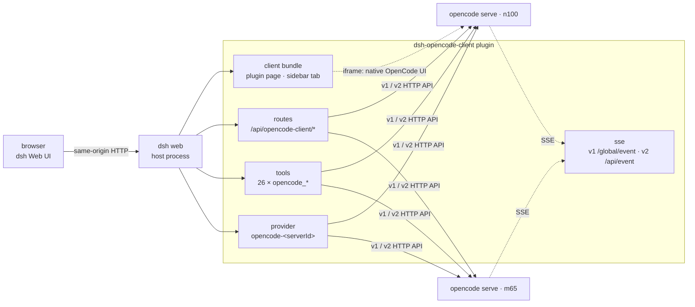

# dsh-opencode-client

<p align="center">
  <a href="https://github.com/yhuan416/dsh-opencode-client/releases"></a>
  <a href="LICENSE"></a>
  
  
  
  <a href="https://github.com/yhuan416/dsh-opencode-client/actions/workflows/check.yml"></a>
</p>

> English | [中文](README.zh.md)

**OpenCode as a native dsh subagent backend, plus a client for every remote `opencode serve`.**
The plugin connects to one or more remote `opencode serve` instances, exposes their projects,
sessions and messages to dsh as tools and HTTP routes, delegates tasks into them, and registers
each server as a native dsh subagent provider (`opencode-<serverId>`).

**Compatibility**: one install serves **OpenCode 1.18.x (v1 HTTP API)** and **OpenCode 2.x
(v2 `/api/*` API + HTTP Basic auth)**. The generation is detected per server
(`apiVersion: auto|1|2`); `auto` probes `GET /api/info` and falls back to v1 with a recorded
reason. See [Compatibility & versioning](#compatibility--versioning).

> **Primary role**: register OpenCode as a native dsh subagent backend
> (`opencode_subagent_<server>`) and expose remote sessions/workspaces as tools
> (`opencode_subagent`, `opencode_prompt`, shell/git/read/find, catalogs). The embedded OpenCode
> Web UI is an optional convenience for full-fidelity work, not a replacement for the OpenCode
> client.

## Table of contents

- [Quick start](#quick-start) · [Architecture](#architecture) · [Features](#features)
- [Install (profile)](#install-profile) · [Configuration](#configuration) · [Subagent seam](#subagent-seam)
- [Documentation](#documentation) · [Ecosystem](#ecosystem) · [Compatibility & versioning](#compatibility--versioning) · [Notes](#notes)

## Quick start

```sh
# 1. install the plugin into the web profile (bundle selection is composed at restart)
dsh plugin --profile web add /path/to/dsh-opencode-client

# 2. configure at least one server (full schema in Configuration)
#    OpenCode 2.x also needs the server password:
#    config.servers: [{ id: n100, url: "http://192.168.4.50:4096", password: "<OPENCODE_SERVER_PASSWORD>" }]

# 3. restart dsh web
dsh web
```

Verify:

1. **Settings → Plugins → OpenCode Client** shows the server / workspace / session section
   (`GET /api/opencode-client/list` answers with the configured servers).
2. Ask the agent to call **`opencode_sessions`** — it lists remote sessions, so the HTTP path to
   `opencode serve` works end to end.
3. Optional: expose the server as a native subagent (`opencode_subagent_<server>`) — see
   [Subagent seam](#subagent-seam).

Full live acceptance run (needs a real `opencode serve`; works for v1 and v2):

```sh
OPC_LIVE_URL=http://192.168.4.50:4096 \
OPC_LIVE_PASSWORD='<OPENCODE_SERVER_PASSWORD>' \
OPC_LIVE_DIR=/home/yhuan/workspace \
node scripts/e2e-live.mjs        # or: npm run e2e; OPC_LIVE_INTERACTIONS=1 also exercises approval/question bridging
```

`OPC_LIVE_PASSWORD` is required for OpenCode 2 and optional for OpenCode 1.18.x. Offline checks:
`npm test` (unit + transport tests) or `npm run check` (smoke checks + tests).

Prerequisite: `opencode serve` must be reachable from the dsh host. It binds `127.0.0.1` by
default — bind `0.0.0.0` or put it behind an SSH tunnel. **OpenCode 2 always requires
`OPENCODE_SERVER_PASSWORD` on the serve process plus the same value in the plugin's server
`password`**; for OpenCode 1.18.x it is recommended.

## Architecture

OpenCode's own architecture: `opencode serve` exposes an OpenAPI HTTP server "that an opencode
client can use"; the TUI / Web / SDK are clients of it. This plugin is another client, hosted in
dsh.



The browser only talks to the **dsh origin** — `lib/client.js` renders the plugin page and the
right-sidebar tab and embeds the native OpenCode UI in an iframe. `lib/routes.js`
(`/api/opencode-client/*`) and the model-facing `opencode_*` tools (`lib/tools.js`) make
deterministic HTTP calls through the per-server v1 or v2 transport; `lib/provider.js`
(`opencode-<serverId>`) and `lib/session-run.js` drive delegated runs; `lib/sse.js` subscribes to
each server's event stream (v1 `/global/event`, v2 `/api/event` with Basic auth; with reconnect)
for live progress, completion and permission/question bridging. `lib/http.js` probes
`GET /api/info` once per server, prefixes v2 requests with `/api` and adds HTTP Basic auth
(v1 paths are untouched).

More: [ARCHITECTURE.md](ARCHITECTURE.md) · [docs/ARCHITECTURE.zh.md](docs/ARCHITECTURE.zh.md).

## Features

26 model-facing `opencode_*` tools, host routes, one native subagent provider per server — the
same tool names and behaviour on OpenCode 1.18.x (v1 API) and OpenCode 2.x (v2 API), with four
explicit v2 exceptions listed below.

### OpenCode 1.18.x vs 2.x

One install speaks both API generations; the generation is detected per server and the 26
`opencode_*` tool names are identical on both. Two capabilities have no OpenCode 2 endpoint and
return an explicit "not available on OpenCode 2" message instead of silently returning empty data;
two more are restored through v2-native fallbacks:

| Capability | OpenCode 1.18.x (v1) | OpenCode 2.x (v2) |
|---|---|---|
| `opencode_*` tools and modes not listed below | supported | supported |
| `opencode_share` | share / unshare link | **not available** (no share endpoint) |
| `opencode_tools` | tool-id catalog | **not available** (no tool-ids endpoint) |
| `opencode_find` with `kind=text` | content search | **restored via fallback**: v2 has no content-search endpoint, so the plugin runs workspace `grep` through the async shell (literal substring, first 100 matches) |
| todo list in `opencode_session_info` | todo items | **restored via fallback**: v2 removed `/session/{id}/todo`, so todos are derived from the last `todowrite` tool call |

On v2 the plugin also absorbs these API differences for you:

- Sessions carry `location.directory`; session/message/diff results are normalized to the v1 shapes.
- Prompts are `{text, files}`; `agent` and `model` are session state
  (`POST /api/session/{id}/agent|model`) rather than prompt-body fields as in v1.
- Completion is detected from `session.execution.succeeded|failed|interrupted` events (v1 keeps
  `session.idle`).
- Permission approvals use `once|always|reject`; questions arrive as forms with typed fields
  (string / number / integer / boolean / multiselect).
- `opencode_shell` runs asynchronously in the session workspace (submit, poll, read output).
- `opencode_summarize` maps to `compact` (the session's own model is used, so `model` is optional
  on v2); `opencode_init` runs the built-in `init` command; `opencode_git_diff` maps `git` → v2's
  `working`; `opencode_find` retries a glob query as a plain substring on v2 (the v2 endpoint does
  not understand `*`/`?`).

### Subagent delegation

- **Native subagent** — provider `opencode-<serverId>`; pair with `@deepseek-ai/dsh-tool-subagent`
  to expose one-shot `opencode_subagent_<server>` tools.
- **Delegation** — tool `opencode_subagent` (new session, or continue with `session=`; optional
  `agent`, `model` and prompt-enforced `schema`); uses `prompt_async` + message polling with a
  blocking-prompt fallback, and returns the final answer plus the session id. On v2 the prompt is
  `{text, files}` and `agent`/`model` are applied as session state.
- **Turn-by-turn continuation** — `opencode_prompt` sends one message to an existing remote session
  (fire-and-forget by default, `wait=true` to block); read the reply with
  `opencode_messages`/`opencode_progress` and send the next message. This keeps a remote worker
  session alive across dsh turns.
- **Completion wait** — `prompt_async` + SSE event-driven (returns immediately when the remote
  finishes), 5 s polling fallback, then a fallback to the blocking prompt endpoint. v1 completes on
  `session.idle`; v2 on `session.execution.succeeded|failed|interrupted`.
- **Live progress** — `opencode_progress` (current tool/step, elapsed, output tail) fed by SSE
  tool events; delegation completes on the SSE completion event (version-split as above).
- **Abort** — `opencode_abort` stops a running remote session (v1 `/abort`, v2 `/interrupt`); a
  waiting delegation returns an abort error instead of hanging. Call it from another dsh
  session/agent: tool calls inside one turn are serialized, so it cannot preempt a blocking
  `opencode_subagent` in the same turn.
- **Attachments** — `opencode_subagent` accepts a `files` JSON array (text/base64 → data URL; v2
  sends `{uri, name}` file attachments).

### Sessions & messages

- **Server configuration** — `servers: [{ id, label?, url, password?, directory? }]`, with optional
  per-server default `agent` and `model`.
- **Discovery** — `GET /api/opencode-client/list` (server health, projects, sessions grouped by
  directory; on v2 the directory comes from `location.directory`).
- **Session listing** — tool `opencode_sessions` + `GET /api/opencode-client/sessions`.
- **Session messages** — tool `opencode_messages` + `GET /api/opencode-client/messages` (text, tool
  and file parts; v2 `content[]` text/reasoning/tool parts are normalized); useful to decide
  whether a session is the right one to continue.
- **Session info** — tool `opencode_session_info` (title/summary/todos/diff; on OpenCode 2 the todo
  list is derived from the last `todowrite` call and outcome/cost/tokens plus the changed-file diff
  are reported) and `opencode_share` (share/unshare link; v1 only — OpenCode 2 removed the endpoint
  and the tool says so).
- **Session management** — `opencode_fork`, `opencode_children`, `opencode_summarize` (mutating;
  v2 maps it to `compact`, where the session's own model is used and `model` is optional),
  `opencode_init` (writes AGENTS.md, requires `confirm=true`; on v2 it runs the built-in `init`
  command).
- **Session search & diagnostics** — `opencode_search` (v2 session search through the list
  endpoint's `search` filter; v1 filters titles locally), `opencode_mcp` (MCP server status).
- **Multiple servers** — configured as an array and aggregated by the client (opencode itself has
  no server-side federation).

### Catalogs & tool discovery

- **Agent catalog** — tool `opencode_agents` + `GET /api/opencode-client/agents`
  (primary/subagent, native/custom); call it before `opencode_subagent` to pick an agent name.
- **Catalogs** — `opencode_models` (providers/models, credentials stripped), `opencode_commands`,
  `opencode_skills`, `opencode_tools` (v1 only; OpenCode 2 has no tool-ids endpoint),
  `opencode_references`.
- **Command execution** — `opencode_command` runs a remote command (e.g. `init`) inside a session
  and returns its final text.

### Workspace & git

- **Workspace ops** — `opencode_shell`, `opencode_git_status`, `opencode_git_diff`,
  `opencode_read_file`, `opencode_find` (file-path search, or text-content search on v1; on v2
  `kind=file` works and `kind=text` returns an explicit message).
- These are deterministic direct calls (no remote model involved): verify what a remote agent
  changed, read a file, run a command, or search the workspace.
- Version notes: `opencode_shell` is synchronous on v1 and asynchronous on v2 (submit, poll, read
  output) in the session workspace; `opencode_git_diff` accepts `committed`/`branch`/`working` on
  v2, with `git` mapped to `working`.

### Permissions & events

- **Permission approval** — `permission: ask` (default) turns remote permission requests into dsh
  approval cards; `allow`/`reject` answer deterministically (v2 replies `once`/`always`/`reject`).
- **Question bridging** — remote questions are forwarded to dsh's user-question UI for
  tool-initiated runs (an agent is in scope); otherwise they are rejected. On v2 questions are
  forms with typed fields (string / number / integer / boolean / multiselect).
- **Live events** — per-server SSE subscription (v1 `/global/event`, v2 `/api/event`) with reconnect; fast
  permission/question handling, live state, `GET /api/opencode-client/events` and `/status`.
- **Polling fallback** — permission/question requests are answered while a delegated run is active:
  SSE events are handled immediately, with a 15 s polling fallback when the stream is unavailable.

### UI

- **Plugin page** — "OpenCode Client" section: servers/workspaces/sessions, session ids, active
  tool, messages, create session.
- **Embedded OpenCode UI** — register a right-sidebar tab (`kind: opencode`): server picker + iframe
  of the real OpenCode Web UI, inside the current session page. Open it from a server's
  "侧边栏打开" button or the right-sidebar add-tab guide; "全屏" overlay and "新标签" remain as
  fallbacks. No reimplementation — the embedded page keeps streaming, tool cards, diffs and
  permissions.
- **Entry points** — the same embedded UI is reachable from the left sidebar panel column and from
  the session-header "OpenCode" button.

## Install (profile)

```sh
# A. dsh plugin manager
dsh plugin --profile web add /path/to/dsh-opencode-client

# B. helper script: symlink + dependency + bundle selection + a starter server row
bash scripts/install-into-profile.sh http://192.168.4.50:4096 n100
```

or add it manually to the profile and select it as a bundle:

```json
{
  "dependencies": { "dsh-opencode-client": "file:/path/to/dsh-opencode-client" },
  "dsh": { "profile": { "bundles": ["@deepseek-ai/dsh-base", "@deepseek-ai/dsh-web-app", "dsh-opencode-client"] } }
}
```

Restart `dsh web` afterwards: the bundle selection is composed at startup.

## Configuration

```yaml
- id: opencode-client
  name: dsh-opencode-client
  config:
    servers:
      # OpenCode 2.x: start the server with OPENCODE_SERVER_PASSWORD=<secret> and repeat
      # the same value in `password` (HTTP Basic auth, user "opencode").
      - id: n100
        label: n100 opencode 2.x
        url: http://192.168.4.50:4096
        apiVersion: auto            # auto (probe GET /api/info) | 1 | 2
        password: "<OPENCODE_SERVER_PASSWORD>"
        # directory: /home/yhuan/workspace   # default remote dir when the caller does not give one
        # agent: plan            # default OpenCode agent for delegation
        # model: deepseek/deepseek-chat      # default model "provider/model"
      # OpenCode 1.18.x: password is optional (recommended when exposed over the network).
      - id: m65
        label: 4.65 opencode 1.18
        url: http://192.168.4.65:4096
        apiVersion: 1
    permission: ask              # ask (default, dsh approval card) | allow | reject
    question: reject             # reject (default) interactive questions or "ignore" them
    pathMap:                     # only when local and remote path layouts differ
      - { from: /home/yhuan, to: /home/yhuan }
    routing:                     # multi-server subagent dispatch (default: on when servers > 1)
      providerName: opencode-auto
      policy: [directory, sticky, least-busy, round-robin]
      sticky: true               # keep one parent agent on the server that accepted its first child
      failover: true             # try the next candidate when a start fails before publication
```

`apiVersion: auto` (the default) asks `GET /api/info` once per server. If the probe is rejected
with 401, the password is missing, or the endpoint does not answer with JSON, the server is
treated as v1 and the reason is recorded on `server.versionProbe` (logged once) — on OpenCode 2
the tools then fail with a 401 hint until `password` matches `OPENCODE_SERVER_PASSWORD`. Force
`apiVersion: 1` or `2` to skip probing. For a v2 server, sanity-check with
`curl -u opencode:$OPENCODE_SERVER_PASSWORD http://host:4096/api/info`.

### Register as a native subagent

To expose an OpenCode server as a native dsh subagent, add a tool row:

```yaml
- insert:
    - id: tool-opencode-n100
      name: "@deepseek-ai/dsh-tool-subagent"
      config:
        provider: opencode-n100   # "opencode-" + server id
        maxDepth: provider-managed
        toolName: opencode_subagent_n100
```

### Multiple servers: `opencode-auto`

`opencode-<server>` providers are pinned to one server, so a tool row always dispatches to the
same machine. When more than one server is configured the plugin also registers a routed provider
`opencode-auto` (configurable through `routing`), which chooses per start:

1. `directory` — a server whose `directory` covers the child cwd (only meaningful when servers
   declare `directory`);
2. `sticky` — the server that accepted this parent agent's first child (one parent → one machine);
3. `least-busy` — fewest running sessions (`/session/active`), ties rotate;
4. `round-robin` — rotate through the remaining candidates.

A start that fails before the run is published (unreachable, 5xx, timeout) falls through to the
next candidate when `failover: true`; the chosen server is appended to the session title
(`dsh subagent: <label> @n100`) and logged. Expose it as a tool row:

```yaml
- insert:
    - id: tool-opencode-auto
      name: "@deepseek-ai/dsh-tool-subagent"
      config:
        provider: opencode-auto
        maxDepth: provider-managed
        toolName: opencode_subagent_auto
```

Set `directory` per server to enable directory routing (e.g. machines with different mount roots);
without it, routing falls back to sticky / least-busy / round-robin. Continuation is not routed —
a remote session id belongs to one server — so keep using the pinned tools or pass `server` to
`opencode_subagent` when resuming.

## Subagent seam

The native `opencode_subagent_<server>` tools plug into dsh's `ctx.subagents` provider seam.
See [docs/subagent-seam.md](docs/subagent-seam.md) for the contract, our capability
mapping, and the applied optimizations (parent-agent attribution, event-driven wait,
idempotent dispose). Both `opencode_subagent` and the native provider share one
session-run lifecycle (`lib/session-run.js`): same session creation, interaction
tracking, async prompt + SSE completion wait and abort handling. Native subagent sessions are
titled `dsh subagent: <label>` so they are identifiable in the plugin page (which now
also shows session ids and the active tool of running servers). The provider reports
`stopReason` faithfully — `finish=length` becomes `max-tokens` and `content-filter` becomes
`refusal`, so dsh's settlement notice says "ran out of room" / "declined the task" instead of a
generic completion. With multiple servers, `opencode-auto` routes each child (see above).

## Documentation

- [ARCHITECTURE.md](ARCHITECTURE.md) — module map, data flows, design decisions
- [docs/ARCHITECTURE.zh.md](docs/ARCHITECTURE.zh.md) — 中文架构（与 ARCHITECTURE.md 对应）
- [docs/TOOLS.zh.md](docs/TOOLS.zh.md) — 中文工具总览：26 个 `opencode_*` 工具、参数、只读/可变
- [COMPATIBILITY.md](COMPATIBILITY.md) — dsh / OpenCode compatibility matrix and versioning policy
- [docs/opencode-v2-migration.zh.md](docs/opencode-v2-migration.zh.md) — measured OpenCode 2.3.0 gaps and the phased migration plan now implemented in 0.2.0
- [docs/opencode-v2-deeper-integration.zh.md](docs/opencode-v2-deeper-integration.zh.md) — measured survey of the 100 unused OpenCode 2.3.0 endpoints and the candidate deeper-integration roadmap (inbox/steer, revert checkpoints, worktrees, stats, PTY, reverse MCP)
- [docs/subagent-seam.md](docs/subagent-seam.md) — dsh subagent provider contract
- [docs/chat-ui-proposal.md](docs/chat-ui-proposal.md) — in-page remote-session chat proposal
- [scripts/e2e-live.mjs](scripts/e2e-live.mjs) — live acceptance run against a real v1/v2 server (offline checks stay `npm test` / `npm run check`)
- [README.zh.md](README.zh.md) · [TODO.md](TODO.md) · [CHANGELOG.md](CHANGELOG.md)

## Ecosystem

| Project | Role |
|---|---|
| [dsh-remote-hub](https://github.com/yhuan416/dsh-remote-hub) | Hub side: one dsh Web UI for every backend — reverse proxy, managed SSH tunnels, top-bar switcher, remote subagent providers. |
| [dsh-remote-agent](https://github.com/yhuan416/dsh-remote-agent) | Remote side: runs in each backend `dsh web` and publishes its launch token + identity so the hub needs no manual token copy. |
| **dsh-opencode-client** (this repo) | Sidecar: treats remote `opencode serve` instances as a dsh subagent backend and client (sessions, delegation, catalogs) — independent of dsh remotes. |

## Compatibility & versioning

See [COMPATIBILITY.md](COMPATIBILITY.md) for the test matrix and versioning policy.

| Component | Version | Status |
|---|---|---|
| dsh | `>=0.2.1-rc.2` (verified against `0.2.1-rc.2`) | supported |
| OpenCode 1.18.x (v1 API) | `1.18.10` / `1.18.31` / `1.18.33` | supported (baseline) |
| OpenCode 2.x (v2 API) | v2 `/api/*` + HTTP Basic auth (verified against `2.3.0`) | supported end to end; four documented tool gaps |

The plugin follows independent semantic versioning and is **not published to npm** for now
(install from git or a local path). **`0.2.0` is the "OpenCode v2 support" release**: one install
serves both API generations, with `apiVersion: auto|1|2` per server; `0.1.x` is the v1-only line.
The v2 probe and the four v2 limitations are described in
[Features](#opencode-118x-vs-2x); the measured gaps and the phased plan that 0.2.0 completes live
in [docs/opencode-v2-migration.zh.md](docs/opencode-v2-migration.zh.md).

## Notes

- The remote OpenCode server must be reachable from the dsh host; `opencode serve` binds
  `127.0.0.1` by default — bind `0.0.0.0` or put it behind an SSH tunnel. OpenCode 2 requires
  `OPENCODE_SERVER_PASSWORD` on the serve process and the same value in the plugin `password`
  (without it the probe falls back to v1 and tools fail with a 401 hint); for OpenCode 1.18.x it
  is recommended.
- Session continuation is done through the OpenCode HTTP API; native external subagents still
  execute once (matching Codex/Claude Code backends).
- Interactive questions asked by the remote agent are forwarded to dsh's user-question UI when the
  run was started by `opencode_subagent` (an agent is in scope); otherwise they are rejected. On
  v2 the same bridge answers typed forms.
- **Structured output is prompt-enforced, not `format=`-enforced**: **OpenCode 1.18.x** has an
  upstream bug — after a prompt carrying `format: {type:"json_schema"}`, it persists a
  `retryCount` field that makes `GET /session/{id}/message` return 400 (BadRequest), poisoning the
  session. The plugin therefore appends a "return only JSON matching this schema" instruction and
  validates the result locally (`schema` parameter), leaving the session readable.
- **Permission cards need a tool-initiated run**: approval bridging uses the calling agent; a
  delegation started over the HTTP endpoint (no agent in scope) falls back to `allow`/`reject`
  (v2: `once`/`always`/`reject`).
- **Multiple servers** are configured as an array and aggregated by the client (opencode itself has
  no server-side federation); v1 and v2 servers can be mixed in one config.
- Permission/question requests are answered while a delegated run is active: SSE events are handled
  immediately, with a 15s polling fallback when the stream is unavailable.
- The plugin page shows `live` (SSE connected) and the number of currently running sessions.
- **Both API generations are supported**: the version is probed or forced per server and requests
  are routed accordingly — v1 paths are untouched, v2 requests carry the `/api` prefix plus Basic
  auth. The remaining v2 gaps (`opencode_share`, `opencode_tools`) fail with an explicit "not
  available on OpenCode 2" message rather than empty data; content search and session todos are
  restored by v2-native fallbacks (see [Features](#opencode-118x-vs-2x) and
  [COMPATIBILITY.md](COMPATIBILITY.md)).
