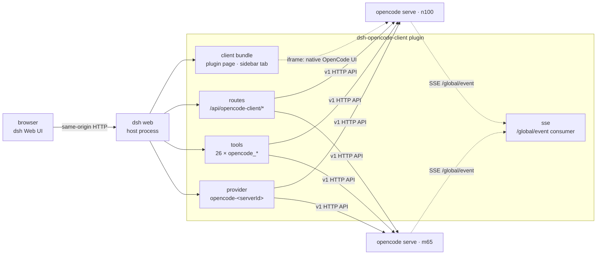

# dsh-opencode-client

<p align="center">
  <a href="https://github.com/yhuan416/dsh-opencode-client/releases"></a>
  <a href="LICENSE"></a>
  
  
  <a href="https://github.com/yhuan416/dsh-opencode-client/actions/workflows/check.yml"></a>
</p>

> English | [中文](README.zh.md)

**OpenCode as a native dsh subagent backend, plus a client for every remote `opencode serve`.**
The plugin connects to one or more remote `opencode serve` instances, exposes their projects,
sessions and messages to dsh as tools and HTTP routes, delegates tasks into them, and registers
each server as a native dsh subagent provider (`opencode-<serverId>`).

> **Primary role**: register OpenCode as a native dsh subagent backend
> (`opencode_subagent_<server>`) and expose remote sessions/workspaces as tools
> (`opencode_subagent`, `opencode_prompt`, shell/git/read/find, catalogs). The embedded OpenCode
> Web UI is an optional convenience for full-fidelity work, not a replacement for the OpenCode
> client.

## Table of contents

- [Quick start](#quick-start) · [Architecture](#architecture) · [Features](#features)
- [Install (profile)](#install-profile) · [Configuration](#configuration) · [Subagent seam](#subagent-seam)
- [Documentation](#documentation) · [Ecosystem](#ecosystem) · [Compatibility & versioning](#compatibility--versioning) · [Notes](#notes)

## Quick start

```sh
# 1. install the plugin into the web profile (bundle selection is composed at restart)
dsh plugin --profile web add /path/to/dsh-opencode-client

# 2. configure at least one server (full schema in Configuration)
#    config.servers: [{ id: n100, url: "http://192.168.4.50:4096" }]

# 3. restart dsh web
dsh web
```

Verify:

1. **Settings → Plugins → OpenCode Client** shows the server / workspace / session section
   (`GET /api/opencode-client/list` answers with the configured servers).
2. Ask the agent to call **`opencode_sessions`** — it lists remote sessions, so the HTTP path to
   `opencode serve` works end to end.
3. Optional: expose the server as a native subagent (`opencode_subagent_<server>`) — see
   [Subagent seam](#subagent-seam).

Prerequisite: `opencode serve` must be reachable from the dsh host. It binds `127.0.0.1` by
default — bind `0.0.0.0` or put it behind an SSH tunnel, and set `OPENCODE_SERVER_PASSWORD`.

## Architecture

OpenCode's own architecture: `opencode serve` exposes an OpenAPI HTTP server "that an opencode
client can use"; the TUI / Web / SDK are clients of it. This plugin is another client, hosted in
dsh.



The browser only talks to the **dsh origin** — `lib/client.js` renders the plugin page and the
right-sidebar tab and embeds the native OpenCode UI in an iframe. `lib/routes.js`
(`/api/opencode-client/*`) and the model-facing `opencode_*` tools (`lib/tools.js`) make
deterministic v1 HTTP calls; `lib/provider.js` (`opencode-<serverId>`) and `lib/session-run.js`
drive delegated runs; `lib/sse.js` subscribes to each server's `/global/event` stream (with
reconnect) for live progress, idle-based completion and permission/question bridging.

More: [ARCHITECTURE.md](ARCHITECTURE.md) · [docs/ARCHITECTURE.zh.md](docs/ARCHITECTURE.zh.md).

## Features

26 model-facing `opencode_*` tools, host routes, one native subagent provider per server.

### Subagent delegation

- **Native subagent** — provider `opencode-<serverId>`; pair with `@deepseek-ai/dsh-tool-subagent`
  to expose one-shot `opencode_subagent_<server>` tools.
- **Delegation** — tool `opencode_subagent` (new session, or continue with `session=`; optional
  `agent`, `model` and prompt-enforced `schema`); uses `prompt_async` + message polling with a
  blocking-prompt fallback, and returns the final answer plus the session id.
- **Turn-by-turn continuation** — `opencode_prompt` sends one message to an existing remote session
  (fire-and-forget by default, `wait=true` to block); read the reply with
  `opencode_messages`/`opencode_progress` and send the next message. This keeps a remote worker
  session alive across dsh turns.
- **Completion wait** — `prompt_async` + SSE `session.idle` event-driven (returns immediately when
  the remote goes idle), 5 s polling fallback, then a fallback to the blocking prompt endpoint.
- **Live progress** — `opencode_progress` (current tool/step, elapsed, output tail) fed by SSE
  tool events; delegation completes on the SSE idle event.
- **Abort** — `opencode_abort` stops a running remote session; a waiting delegation returns an abort
  error instead of hanging. Call it from another dsh session/agent: tool calls inside one turn are
  serialized, so it cannot preempt a blocking `opencode_subagent` in the same turn.
- **Attachments** — `opencode_subagent` accepts a `files` JSON array (text/base64 → data URL file
  parts).

### Sessions & messages

- **Server configuration** — `servers: [{ id, label?, url, password?, directory? }]`, with optional
  per-server default `agent` and `model`.
- **Discovery** — `GET /api/opencode-client/list` (server health, projects, sessions grouped by
  directory).
- **Session listing** — tool `opencode_sessions` + `GET /api/opencode-client/sessions`.
- **Session messages** — tool `opencode_messages` + `GET /api/opencode-client/messages` (text, tool
  and file parts); useful to decide whether a session is the right one to continue.
- **Session info** — tool `opencode_session_info` (title/summary/todos/diff) and `opencode_share`
  (share/unshare link).
- **Session management** — `opencode_fork`, `opencode_children`, `opencode_summarize` (mutating),
  `opencode_init` (writes AGENTS.md, requires `confirm=true`).
- **Session search & diagnostics** — `opencode_search` (v2 session search, v1 fallback),
  `opencode_mcp` (MCP server status).
- **Multiple servers** — configured as an array and aggregated by the client (opencode itself has
  no server-side federation).

### Catalogs & tool discovery

- **Agent catalog** — tool `opencode_agents` + `GET /api/opencode-client/agents`
  (primary/subagent, native/custom); call it before `opencode_subagent` to pick an agent name.
- **Catalogs** — `opencode_models` (providers/models, credentials stripped), `opencode_commands`,
  `opencode_skills`, `opencode_tools`, `opencode_references`.
- **Command execution** — `opencode_command` runs a remote command (e.g. `init`) inside a session
  and returns its final text.

### Workspace & git

- **Workspace ops** — `opencode_shell`, `opencode_git_status`, `opencode_git_diff`,
  `opencode_read_file`, `opencode_find` (file-path or text-content search).
- These are deterministic direct calls (no remote model involved): verify what a remote agent
  changed, read a file, run a command, or search the workspace.

### Permissions & events

- **Permission approval** — `permission: ask` (default) turns remote permission requests into dsh
  approval cards; `allow`/`reject` answer deterministically.
- **Question bridging** — remote questions are forwarded to dsh's user-question UI for
  tool-initiated runs (an agent is in scope); otherwise they are rejected.
- **Live events** — per-server SSE subscription (`/global/event`) with reconnect; fast
  permission/question handling, live state, `GET /api/opencode-client/events` and `/status`.
- **Polling fallback** — permission/question requests are answered while a delegated run is active:
  SSE events are handled immediately, with a 15 s polling fallback when the stream is unavailable.

### UI

- **Plugin page** — "OpenCode Client" section: servers/workspaces/sessions, session ids, active
  tool, messages, create session.
- **Embedded OpenCode UI** — register a right-sidebar tab (`kind: opencode`): server picker + iframe
  of the real OpenCode Web UI, inside the current session page. Open it from a server's
  "侧边栏打开" button or the right-sidebar add-tab guide; "全屏" overlay and "新标签" remain as
  fallbacks. No reimplementation — the embedded page keeps streaming, tool cards, diffs and
  permissions.
- **Entry points** — the same embedded UI is reachable from the left sidebar panel column and from
  the session-header "OpenCode" button.

## Install (profile)

```sh
# A. dsh plugin manager
dsh plugin --profile web add /path/to/dsh-opencode-client

# B. helper script: symlink + dependency + bundle selection + a starter server row
bash scripts/install-into-profile.sh http://192.168.4.50:4096 n100
```

or add it manually to the profile and select it as a bundle:

```json
{
  "dependencies": { "dsh-opencode-client": "file:/path/to/dsh-opencode-client" },
  "dsh": { "profile": { "bundles": ["@deepseek-ai/dsh-base", "@deepseek-ai/dsh-web-app", "dsh-opencode-client"] } }
}
```

Restart `dsh web` afterwards: the bundle selection is composed at startup.

## Configuration

```yaml
- id: opencode-client
  name: dsh-opencode-client
  config:
    servers:
      - id: n100
        label: n100 opencode
        url: http://192.168.4.50:4096
        # password: xxx          # OPENCODE_SERVER_PASSWORD (basic auth, user "opencode")
        # directory: /home/yhuan/workspace   # default remote dir when the caller does not give one
        # agent: plan            # default OpenCode agent for delegation
        # model: deepseek/deepseek-chat      # default model "provider/model"
      - id: m65
        label: 4.65 opencode
        url: http://192.168.4.65:4096
    permission: ask              # ask (default, dsh approval card) | allow | reject
    question: reject             # reject (default) interactive questions or "ignore" them
    pathMap:                     # only when local and remote path layouts differ
      - { from: /home/yhuan, to: /home/yhuan }
```

To expose an OpenCode server as a native dsh subagent, add a tool row:

```yaml
- insert:
    - id: tool-opencode-n100
      name: "@deepseek-ai/dsh-tool-subagent"
      config:
        provider: opencode-n100   # "opencode-" + server id
        maxDepth: provider-managed
        toolName: opencode_subagent_n100
```

## Subagent seam

The native `opencode_subagent_<server>` tools plug into dsh's `ctx.subagents` provider seam.
See [docs/subagent-seam.md](docs/subagent-seam.md) for the contract, our capability
mapping, and the applied optimizations (parent-agent attribution, event-driven wait,
idempotent dispose). Both `opencode_subagent` and the native provider share one
session-run lifecycle (`lib/session-run.js`): same session creation, interaction
tracking, async prompt + SSE idle wait and abort handling. Native subagent sessions are
titled `dsh subagent: <label>` so they are identifiable in the plugin page (which now
also shows session ids and the active tool of running servers).

## Documentation

- [ARCHITECTURE.md](ARCHITECTURE.md) — module map, data flows, design decisions
- [docs/ARCHITECTURE.zh.md](docs/ARCHITECTURE.zh.md) — 中文架构（与 ARCHITECTURE.md 对应）
- [docs/TOOLS.zh.md](docs/TOOLS.zh.md) — 中文工具总览：26 个 `opencode_*` 工具、参数、只读/可变
- [COMPATIBILITY.md](COMPATIBILITY.md) — dsh / OpenCode compatibility and versioning policy
- [docs/opencode-v2-migration.zh.md](docs/opencode-v2-migration.zh.md) — measured OpenCode 2.3.0 gaps and a phased migration plan (analysis only; v2 is not supported yet)
- [docs/subagent-seam.md](docs/subagent-seam.md) — dsh subagent provider contract
- [docs/chat-ui-proposal.md](docs/chat-ui-proposal.md) — in-page remote-session chat proposal
- [README.zh.md](README.zh.md) · [TODO.md](TODO.md) · [CHANGELOG.md](CHANGELOG.md)

## Ecosystem

| Project | Role |
|---|---|
| [dsh-remote-hub](https://github.com/yhuan416/dsh-remote-hub) | Hub side: one dsh Web UI for every backend — reverse proxy, managed SSH tunnels, top-bar switcher, remote subagent providers. |
| [dsh-remote-agent](https://github.com/yhuan416/dsh-remote-agent) | Remote side: runs in each backend `dsh web` and publishes its launch token + identity so the hub needs no manual token copy. |
| **dsh-opencode-client** (this repo) | Sidecar: treats remote `opencode serve` instances as a dsh subagent backend and client (sessions, delegation, catalogs) — independent of dsh remotes. |

## Compatibility & versioning

See [COMPATIBILITY.md](COMPATIBILITY.md). The plugin follows independent semantic versioning, is
verified against dsh `0.2.1-rc.2` and OpenCode `1.18.10/1.18.31/1.18.33`, and is not published to
npm for now (install from git or a local path).

## Notes

- The remote OpenCode server must be reachable from the dsh host; `opencode serve` binds
  `127.0.0.1` by default — bind `0.0.0.0` or put it behind an SSH tunnel; setting
  `OPENCODE_SERVER_PASSWORD` is recommended.
- Session continuation is done through the OpenCode HTTP API; native external subagents still
  execute once (matching Codex/Claude Code backends).
- Interactive questions asked by the remote agent are forwarded to dsh's user-question UI when the
  run was started by `opencode_subagent` (an agent is in scope); otherwise they are rejected.
- **Structured output is prompt-enforced, not `format=`-enforced**: opencode 1.18.x has an upstream
  bug — after a prompt carrying `format: {type:"json_schema"}`, it persists a `retryCount` field
  that makes `GET /session/{id}/message` return 400 (BadRequest), poisoning the session. The plugin
  therefore appends a "return only JSON matching this schema" instruction and validates the result
  locally (`schema` parameter), leaving the session readable.
- **Permission cards need a tool-initiated run**: approval bridging uses the calling agent; a
  delegation started over the HTTP endpoint (no agent in scope) falls back to `allow`/`reject`.
- **Multiple servers** are configured as an array and aggregated by the client (opencode itself has
  no server-side federation).
- Permission/question requests are answered while a delegated run is active: SSE events are handled
  immediately, with a 15s polling fallback when the stream is unavailable.
- The plugin page shows `live` (SSE connected) and the number of currently running sessions.
- The **v1 HTTP API is the baseline**; v2 (`/api/*`) is only used where v1 lacks the capability
  (session search, fallback) — see [TODO.md](TODO.md) and [COMPATIBILITY.md](COMPATIBILITY.md).
