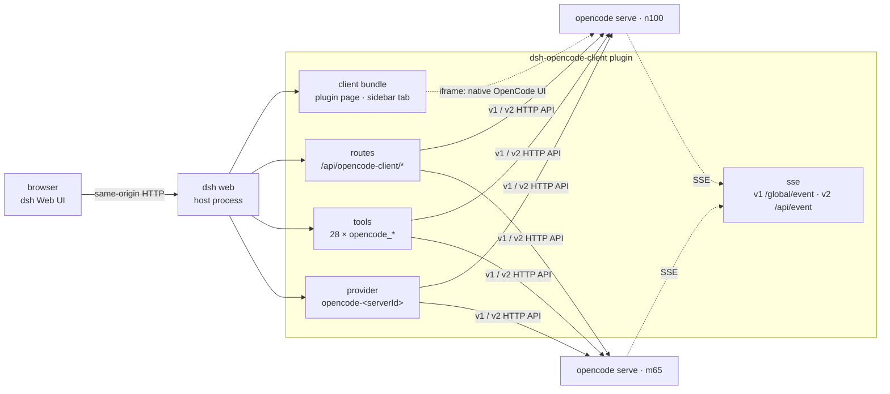

# dsh-opencode-client

<p align="center">
  <a href="https://github.com/yhuan416/dsh-opencode-client/releases"></a>
  <a href="LICENSE"></a>
  
  
  
  <a href="https://github.com/yhuan416/dsh-opencode-client/actions/workflows/check.yml"></a>
</p>

> 中文 | [English](README.md)

**OpenCode 机群的观测台，同时是 dsh 的原生子代理后端。**
插件连接一台或多台远端 `opencode serve`，回答 OpenCode 自己的客户端回答不了的三件事：
**所有 server 上谁在跑、谁在等我、谁挂了**；再把任务委派进去，并把每台 server 注册为
dsh 原生 subagent provider（`opencode-<serverId>`）。

> **定位（0.6.0）**：会话访问是手段，不是目的。会话内的对话交给 OpenCode 自己的 TUI/Web
> （我们只做深链跳转）；这个插件负责跨 server 的看板、注意力聚合、以及面向 agent 的后端。

**兼容性**：同一份安装同时服务 **OpenCode 1.18.x（v1 HTTP API）** 与 **OpenCode 2.x
（v2 `/api/*` API + HTTP Basic 认证）**。版本按 server 探测（`apiVersion: auto|1|2`）；
`auto` 会探测 `GET /api/info`，失败时回退到 v1 并记录原因。详见
[兼容性与版本](#兼容性与版本)。

> **定位**：核心能力是把 OpenCode 注册为 dsh 的**原生 subagent 后端**
> （`opencode_subagent_<server>`），并把远端会话/工作区暴露为工具（`opencode_subagent`、
> `opencode_prompt`、shell/git/read/find、各类目录）。嵌入的 OpenCode Web UI 只是可选的完整
> 功能入口，不替代 OpenCode 客户端。

## 目录

- [快速开始](#快速开始) · [架构](#架构) · [功能](#功能)
- [安装](#安装) · [配置](#配置) · [Subagent 接缝](#subagent-接缝)
- [文档](#文档) · [生态](#生态) · [兼容性与版本](#兼容性与版本) · [说明与限制](#说明与限制)

## 快速开始

```sh
# 1. 把插件装进 web profile（bundle 选择在重启时组合）
dsh plugin --profile web add /path/to/dsh-opencode-client

# 2. 至少配置一台 server（完整字段见「配置」）
#    OpenCode 2.x 还需要 server 密码：
#    config.servers: [{ id: n100, url: "http://192.168.4.50:4096", password: "<OPENCODE_SERVER_PASSWORD>" }]

# 3. 重启 dsh web
dsh web
```

验证：

1. **设置 → 插件 → OpenCode Client** 出现服务器 / 工作区 / 会话区块
   （`GET /api/opencode-client/list` 能返回已配置的 servers）。
2. 让 agent 调用 **`opencode_sessions`** —— 能列出远端会话，说明到 `opencode serve` 的 HTTP
   链路端到端可用。
3. 可选：把该 server 暴露为原生 subagent（`opencode_subagent_<server>`）——见
   [Subagent 接缝](#subagent-接缝)。

真实环境的完整验收（需要一台真实 `opencode serve`；v1 / v2 都适用）：

```sh
OPC_LIVE_URL=http://192.168.4.50:4096 \
OPC_LIVE_PASSWORD='<OPENCODE_SERVER_PASSWORD>' \
OPC_LIVE_DIR=/home/yhuan/workspace \
node scripts/e2e-live.mjs        # 或 npm run e2e；OPC_LIVE_INTERACTIONS=1 还会验证权限/提问桥接
```

`OPC_LIVE_PASSWORD` 对 OpenCode 2 必填、对 OpenCode 1.18.x 可选。离线检查：`npm test`
（单元 + 传输层测试）或 `npm run check`（冒烟检查 + 测试）。

前提：远端 OpenCode 需从 dsh 宿主可达；`opencode serve` 默认绑 `127.0.0.1`，网络访问需绑
`0.0.0.0` 或走 SSH 隧道。**OpenCode 2 必须**在 serve 进程设置
`OPENCODE_SERVER_PASSWORD`，并在插件 server 配置里填同一个 `password`；OpenCode 1.18.x 建议
设置。

## 架构

OpenCode 的官方架构：`opencode serve` 暴露 OpenAPI HTTP 服务，"an opencode client can use"；
TUI / Web / SDK 都是它的客户端。本插件是另一个客户端，宿主在 dsh 里。



浏览器只与 **dsh 同源**通信 —— `lib/client.js` 渲染插件页和右侧栏标签页，并用 iframe 嵌入
OpenCode 原生 UI。`lib/routes.js`（`/api/opencode-client/*`）与面向模型的 `opencode_*` 工具
（`lib/tools.js`）通过按 server 选定的 v1 或 v2 传输发出确定性 HTTP 调用；`lib/provider.js`
（`opencode-<serverId>`）和 `lib/session-run.js` 驱动委派运行；`lib/sse.js` 订阅每台 server 的
事件流（v1 `/global/event`、v2 `/api/event` 带 Basic 认证；带重连），提供实时进度、完成判定与
权限/提问桥接。`lib/http.js` 每台 server 只探测一次 `GET /api/info`，对 v2 请求加 `/api` 前缀
与 HTTP Basic 认证（v1 路径保持不变）。

更多：[ARCHITECTURE.md](ARCHITECTURE.md) · [docs/ARCHITECTURE.zh.md](docs/ARCHITECTURE.zh.md)。

## 功能

28 个面向模型的 `opencode_*` 工具、宿主 HTTP 路由，以及每台 server 一个原生 subagent
provider —— OpenCode 1.18.x（v1 API）与 OpenCode 2.x（v2 API）下工具名一致，仅有五处版本例外
（见下）。**支持目标是 OpenCode 2；v1 已冻结**：代码保留、离线用例仍覆盖，但不再新增能力，也不再
对 1.18.x 做实机验证（[政策](COMPATIBILITY.md#v1-policy-frozen)）。

### OpenCode 1.18.x 与 2.x

同一份安装同时支持两代 API，版本按 server 探测，28 个 `opencode_*` 工具名在两代上完全一致
（下面 v1 列记录的是冻结路径的现有行为，不是支持承诺）；
但有四个能力在 OpenCode 2 上没有对应端点 —— 它们会返回明确的「not available on OpenCode 2」提示，而不是静默返回
空数据。另有两项在 v2 上**通过 v2 原生能力补回**，一项**仅 v2 可用**：

| 能力 | OpenCode 1.18.x（v1） | OpenCode 2.x（v2） |
|---|---|---|
| 下表之外的 `opencode_*` 工具与模式 | 支持 | 支持 |
| `opencode_share` | share / unshare 链接 | **不可用**（v2 没有 share 端点） |
| `opencode_tools` | 工具 id 目录 | **不可用**（v2 没有 tool-ids 端点） |
| `opencode_find` 的 `kind=text` | 文本内容搜索 | **已补回**：v2 无内容搜索端点，改用异步 shell 跑工作区 `grep`（字面子串，最多 100 条） |
| `opencode_session_info` 的 todo 列表 | todo 条目 | **已补回**：v2 移除了 `/session/{id}/todo`，改为从最后一次 `todowrite` 工具调用推导 |
| `opencode_usage` | **不可用**（v1 没有 stats 端点） | **仅 v2**：`GET /experimental/session/stats` 聚合会话数/步数/token/成本/工具成功率 |

v2 上插件还会替你吸收这些 API 差异：

- 会话携带 `location.directory`；session / message / diff 结果会归一化成 v1 形状。
- prompt 是 `{text, files}`；`agent` 与 `model` 是会话状态
  （`POST /api/session/{id}/agent|model`），不再像 v1 那样放在 prompt body 里。
- 完成判定来自 `session.execution.succeeded|failed|interrupted` 事件（v1 仍用
  `session.idle`）。
- 权限审批使用 `once|always|reject`；提问变成带类型字段（string / number / integer / boolean /
  multiselect）的 form。
- `opencode_shell` 在会话工作区异步执行（提交、轮询、读输出）；v2 输出按 cursor 翻页（最多 1 MiB），
  截断会显式提示，并带 exit/signal。
- `opencode_summarize` 映射到 `compact`（使用会话自身的 model，因此 v2 上 `model` 可省略）；
  `opencode_init` 执行内置 `init` 命令；`opencode_git_diff` 把 `git` 映射为 v2 的
  `working`；`opencode_find` 在 v2 上会把 glob 查询退化成子串再试一次（v2 端点不认 `*`/`?`）。

### 子代理委派

- **原生子代理** — provider `opencode-<serverId>`，配合 `@deepseek-ai/dsh-tool-subagent` 可暴露
  一次性执行的 `opencode_subagent_<server>` 工具。
- **委派** — 工具 `opencode_subagent`（新建会话，或 `session=` 续用；可选 `agent`、`model` 与
  prompt 级 `schema`）；走 `prompt_async` + 消息轮询，失败回退阻塞式 prompt，返回最终答案和
  会话 id。v2 上 prompt 为 `{text, files}`，`agent`/`model` 作为会话状态应用。
- **回合制续聊** — `opencode_prompt` 向已有远端会话发一条消息（默认 fire-and-forget，
  `wait=true` 则阻塞等本轮结束）；用 `opencode_messages`/`opencode_progress` 读回复，再发下一条。
  远端会话可跨 dsh 回合长期存活。
- **完成等待** — `prompt_async` + SSE 事件驱动（远端结束立即返回），5s 轮询兜底，再回退到阻塞式
  prompt 接口。v1 以 `session.idle` 完成；v2 以
  `session.execution.succeeded|failed|interrupted` 完成。
- **实时进度** — `opencode_progress`（当前工具/步骤、耗时、输出 tail），由 SSE 工具事件驱动；
  委派完成由 SSE 完成事件触发（按版本如上拆分）。
- **中止** — `opencode_abort` 停止远端运行中的会话（v1 `/abort`，v2 `/interrupt`）；等待中的
  委派会返回 abort 错误而不是继续挂起。注意：同一轮次内 dsh 会串行执行工具调用，因此 abort
  需从**另一个会话/agent** 发起，无法抢占同轮次里阻塞中的 `opencode_subagent`。
- **附件** — `opencode_subagent` 支持 `files` JSON 数组（text/base64 → data URL；v2 发送
  `{uri, name}` 附件）。

### 会话与消息

- **服务配置** — `servers: [{ id, label?, url, password?, directory? }]`，可带每台 server 的默认
  `agent` 与 `model`。
- **发现** — `GET /api/opencode-client/list`（健康状态、projects、按目录分组的 sessions；v2 的
  目录取自 `location.directory`）。
- **会话列表** — 工具 `opencode_sessions` + `GET /api/opencode-client/sessions`；每行在服务端提供时带
  model（含 `#variant`）、agent、outcome 与 cost。
- **会话消息** — 工具 `opencode_messages` + `GET /api/opencode-client/messages`（含 text / tool /
  file part；v2 的 `content[]` text/reasoning/tool part 会归一化）；tool 行带调用入参摘要与输出首行，
  `type=` 可按消息类型过滤（v2 服务端过滤）；可用来判断某会话是否值得续用。
- **会话信息** — 工具 `opencode_session_info`（title/summary/todos/diff、model#variant、agent、
  parent/fork 来源与时间；无 model 时显示 `(server default)`；OpenCode 2 的 todo 从 `todowrite`
  推导）与 `opencode_share`（share/unshare 链接；仅 v1 —— OpenCode 2 移除了该端点，工具会明确说明）。
- **会话管理** — `opencode_fork`、`opencode_children`、`opencode_summarize`（mutating；v2 映射为
  `compact`，使用会话自身 model，`model` 可省略）、`opencode_init`（写 AGENTS.md，需
  `confirm=true`；v2 执行内置 `init` 命令）。
- **会话搜索 / 诊断** — `opencode_search`（v2 通过列表端点的 `search` 过滤；v1 本地按标题过滤）、
  `opencode_mcp`（MCP 服务状态）。
- **多 server** — 以数组配置，由客户端聚合（OpenCode 服务端没有联邦 API）。

### 目录与工具发现

- **Agent 目录** — 工具 `opencode_agents` + `GET /api/opencode-client/agents`（primary/subagent，
  native/custom）；委派前可用它挑 agent 名。
- **目录类** — `opencode_models`（provider/model，凭据已脱敏）、`opencode_commands`、
  `opencode_skills`、`opencode_tools`（仅 v1；OpenCode 2 没有 tool-ids 端点）、
  `opencode_references`。
- **命令执行** — `opencode_command` 在会话内执行远端命令（如 `init`）并返回最终文本。

### 工作区与 git

- **工作区操作** — `opencode_shell`、`opencode_git_status`、`opencode_git_diff`、
  `opencode_read_file`、`opencode_find`（按文件路径搜索；v1 支持文本内容搜索，v2 只有
  `kind=file` 可用，`kind=text` 返回明确提示）。
- 这些都是确定性的直连调用（不经过远端模型）：核对远端 agent 改了什么、读文件、跑命令或搜索
  工作区。
- 版本差异：`opencode_shell` 在 v1 同步、在 v2 异步（提交、轮询、读输出），均在会话工作区执行；
  `opencode_git_diff` 在 v2 接受 `committed`/`branch`/`working`，`git` 映射为 `working`。

### 权限与事件

- **权限审批** — `permission: ask`（默认）把远端权限请求转成 dsh 审批卡；`allow`/`reject`
  确定性应答（v2 回复 `once`/`always`/`reject`）。
- **提问桥接** — 工具发起的运行（有 agent 在作用域）会把远端提问转发到 dsh 用户提问 UI；
  否则自动拒绝。v2 上提问是带类型字段（string / number / integer / boolean / multiselect）的
  form。
- **实时** — 每台 server 常驻 SSE（v1 `/global/event`、v2 `/api/event`），带重连；权限/提问快速应答、
  `GET /api/opencode-client/events`、`/status`、`live`/`running` 状态。
- **轮询兜底** — 委派运行期间权限/提问会被应答：SSE 事件立即处理，流不可用时有 15s 轮询兜底。

### UI

- **观测台（主面板，0.6.0）** — 左侧栏 `OpenCode` 打开的是**卡片看板**，不是内嵌页面：
  「需要你 / 运行中 / 异常」跨远端平铺置顶，「空闲」按远端分组；顶部远端筛选胶囊记住选择；
  点卡片在浮层里打开该会话（Esc 或顶栏关闭，浮层自带「新标签打开」）。数据来自
  `GET /api/opencode-client/board`，5 秒轮询、页面不可见即停。
- **插件页** — 「OpenCode Client」分区：服务器/工作区/会话、会话 id、当前工具、查看消息、
  新建会话。
- **内嵌 OpenCode UI** — 注册右侧栏标签页（`kind: opencode`）：服务器选择 + 真实 OpenCode Web UI
  的 iframe，直接在当前会话页面右侧打开。入口：服务器行「侧边栏打开」或右侧栏「+」里选
  OpenCode；「全屏」浮层和「新标签」作为兜底。嵌入的是完整客户端（流式、工具卡片、diff、
  权限），无需重实现。
- **入口** — 同一内嵌 UI 也可从左侧栏面板列与会话头的「OpenCode」按钮打开。

## 安装

> 装到**另一台机器**（含 Windows / DSH Desktop、多 server 配置、排障）见
> **[docs/INSTALL.zh.md](docs/INSTALL.zh.md)**。

```sh
# 方式一：dsh 插件管理
dsh plugin --profile web add /path/to/dsh-opencode-client

# 方式二：脚本写入 profile（deps + bundles + 起始 server 行）
bash scripts/install-into-profile.sh http://192.168.4.50:4096 n100
```

手动方式（profile）：

```json
{
  "dependencies": { "dsh-opencode-client": "file:/path/to/dsh-opencode-client" },
  "dsh": { "profile": { "bundles": ["@deepseek-ai/dsh-base", "@deepseek-ai/dsh-web-app", "dsh-opencode-client"] } }
}
```

之后需重启 `dsh web`：bundle 选择在启动时组合。

## 配置

```yaml
- id: opencode-client
  name: dsh-opencode-client
  config:
    servers:
      # OpenCode 2.x：serve 进程需设置 OPENCODE_SERVER_PASSWORD=<secret>，
      # 插件配置的 `password` 填同一个值（HTTP Basic，用户名固定 "opencode"）。
      - id: n100
        label: n100 opencode 2.x
        url: http://192.168.4.50:4096
        apiVersion: auto            # auto（探测 GET /api/info）| 1 | 2
        password: "<OPENCODE_SERVER_PASSWORD>"
        # directory: /home/yhuan/workspace   # 调用方未给目录时的默认远端目录
        # agent: plan            # 委派默认 agent
        # model: deepseek/deepseek-chat      # 默认模型 "provider/model"
      # OpenCode 1.18.x：password 可选（暴露在网络上时建议设置）。
      - id: m65
        label: 4.65 opencode 1.18
        url: http://192.168.4.65:4096
        apiVersion: 1
    permission: ask              # ask（默认，审批卡）| allow | reject
    question: reject             # reject（默认）| ignore
    pathMap:                     # 本地/远端路径布局不同时
      - { from: /home/yhuan, to: /home/yhuan }
    routing:                     # 多 server 的子代理派发（servers > 1 时默认开启）
      providerName: opencode-auto
      policy: [directory, sticky, least-busy, round-robin]
      sticky: true               # 同一父 agent 的子代理固定在同一台
      failover: true             # start 发布前失败时换下一台
```

`apiVersion: auto`（默认）每台 server 探测一次 `GET /api/info`。若探测被 401 拒绝、未配置密码，
或端点返回的不是 JSON，则按 v1 处理并在 `server.versionProbe` 记录原因（启动时打印一次）——
此时 OpenCode 2 的工具会以 401 提示失败，直到 `password` 与 `OPENCODE_SERVER_PASSWORD` 一致。
可用 `apiVersion: 1` 或 `2` 跳过探测。v2 server 可先自检：
`curl -u opencode:$OPENCODE_SERVER_PASSWORD http://host:4096/api/info`。

### 注册为原生 subagent

```yaml
- insert:
    - id: tool-opencode-n100
      name: "@deepseek-ai/dsh-tool-subagent"
      config:
        provider: opencode-n100   # "opencode-" + server id
        maxDepth: provider-managed
        toolName: opencode_subagent_n100
```

### 多台 server：`opencode-auto`

`opencode-<server>` provider 与单台 server 绑定，因此一个工具行永远派发到同一台机器。配置了多台
server 时，插件额外注册一个路由 provider `opencode-auto`（可用 `routing` 配置），每次 start 依次
决策：

1. `directory` —— `directory` 覆盖子代理 cwd 的那台（需要各 server 配置 `directory`）；
2. `sticky` —— 该父 agent 的第一个子代理落在哪台，后续仍落那台；
3. `least-busy` —— 运行中会话最少的一台（`/session/active`），并列时轮转；
4. `round-robin` —— 其余情况下轮转。

若 start 在 run 发布前失败（不可达 / 5xx / 超时），`failover: true` 会换下一台候选；选中的 server
会写进会话标题（`dsh subagent: <label> @n100`）并打日志。工具行示例：

```yaml
- insert:
    - id: tool-opencode-auto
      name: "@deepseek-ai/dsh-tool-subagent"
      config:
        provider: opencode-auto
        maxDepth: provider-managed
        toolName: opencode_subagent_auto
```

每台 server 配置 `directory` 才能启用目录路由；不配则退化为 sticky / least-busy / round-robin。
**续聊不路由**：远端会话 id 属于某一台 server，续聊请用固定工具或给 `opencode_subagent` 传
`server`。

## Subagent 接缝

原生 `opencode_subagent_<server>` 工具接入 dsh 的 `ctx.subagents` provider 接缝。
契约、能力映射与已应用的优化（父 agent 归属、事件驱动等待、幂等 dispose）见
[docs/subagent-seam.md](docs/subagent-seam.md)。`opencode_subagent` 与原生 provider 复用同一条
session 运行生命周期（`lib/session-run.js`）：同一套建会话、交互跟踪、异步 prompt + SSE 完成
等待与中止逻辑。原生 subagent 会话标题为 `dsh subagent: <label>`，插件页可直接识别（页面现在也
显示会话 id 和运行中服务器的当前工具）。provider 会如实上报 `stopReason`——`finish=length` 映射为
`max-tokens`、`content-filter` 映射为 `refusal`，dsh 的结算通知会显示"ran out of room"/
"declined the task" 而不是笼统的完成。多台 server 时由 `opencode-auto` 路由（见上）。

## 文档

- [ARCHITECTURE.md](ARCHITECTURE.md) —— 模块地图、数据流、设计决策
- [docs/ARCHITECTURE.zh.md](docs/ARCHITECTURE.zh.md) —— 中文架构（与 ARCHITECTURE.md 对应）
- [docs/TOOLS.zh.md](docs/TOOLS.zh.md) —— 中文工具总览：28 个 `opencode_*` 工具、参数、只读/可变
- [COMPATIBILITY.md](COMPATIBILITY.md) —— dsh / OpenCode 兼容性矩阵与版本策略
- [docs/opencode-v2-migration.zh.md](docs/opencode-v2-migration.zh.md) —— OpenCode 2.3.0 实测兼容缺口，以及 0.2.0 已落地的分阶段迁移计划
- [docs/opencode-v2-deeper-integration.zh.md](docs/opencode-v2-deeper-integration.zh.md) —— 2.3.0 未接入的 100 个端点的实测盘点与深度整合路线（inbox/steer、revert 检查点、worktree、stats、PTY、反向 MCP）
- [docs/subagent-seam.md](docs/subagent-seam.md) —— dsh subagent provider 接缝
- [docs/chat-ui-proposal.md](docs/chat-ui-proposal.md) —— 插件页远端会话聊天提案
- [scripts/e2e-live.mjs](scripts/e2e-live.mjs) —— 对真实 v1/v2 server 的实机验收脚本（离线检查仍为 `npm test` / `npm run check`）
- [README.md](README.md) · [TODO.md](TODO.md) · [CHANGELOG.md](CHANGELOG.md)

## 生态

| 项目 | 职责 |
|---|---|
| [dsh-remote-hub](https://github.com/yhuan416/dsh-remote-hub) | Hub 侧：一个 dsh Web UI 接管所有后端 —— 反向代理、托管 SSH 隧道、顶栏切换、远端 subagent provider。 |
| [dsh-remote-agent](https://github.com/yhuan416/dsh-remote-agent) | 远端侧：运行在每个后端 `dsh web` 里，发布本进程的启动 token + 身份，hub 无需手工拷贝 token。 |
| **dsh-opencode-client**（本仓库） | Sidecar：把远端 `opencode serve` 当作 dsh subagent 后端与客户端（会话、委派、目录），与 dsh remotes 相互独立。 |

## 兼容性与版本

兼容性矩阵与版本策略见 [COMPATIBILITY.md](COMPATIBILITY.md)。

| 组件 | 版本 | 状态 |
|---|---|---|
| dsh | `>=0.2.1-rc.2`（实测 `0.2.1-rc.2`） | 支持 |
| OpenCode 1.18.x（v1 API） | `1.18.10` / `1.18.31` / `1.18.33` | 支持（基线） |
| OpenCode 2.x（v2 API） | v2 `/api/*` + HTTP Basic 认证（实测 `2.3.0`） | 端到端支持；五处已记录的版本例外 |

插件采用独立语义化版本，**暂不发布 npm**（从 git 或本地路径安装）。**`0.2.0` 是
「OpenCode v2 support」版本**：同一份安装支持两代 API，按 server 配置
`apiVersion: auto|1|2`；`0.1.x` 是仅 v1 的版本线。v2 探测与五处版本例外见
[功能](#opencode-118x-与-2x)；实测缺口与 0.2.0 已完成的阶段计划见
[docs/opencode-v2-migration.zh.md](docs/opencode-v2-migration.zh.md)。

## 说明与限制

- 远端 OpenCode 需从 dsh 宿主可达；`opencode serve` 默认绑 `127.0.0.1`，网络访问需绑
  `0.0.0.0` 或走 SSH 隧道。OpenCode 2 必须在 serve 进程设置 `OPENCODE_SERVER_PASSWORD`，并在
  插件 `password` 填同一个值（否则探测回退到 v1，工具会以 401 提示失败）；OpenCode 1.18.x 建议
  设置。
- 会话续用通过 OpenCode HTTP API；原生外部子代理仍是一次性执行（与 Codex/Claude Code 后端一致）。
- 远端 agent 的交互式提问，在运行由 `opencode_subagent` 发起（有 agent 在作用域）时转发到 dsh
  用户提问 UI；否则自动拒绝。v2 上同一桥接会应答带类型的 form。
- **结构化输出是 prompt 约束而非 `format=` 强约束**：**OpenCode 1.18.x** 使用
  `format: {type:"json_schema"}` 后会把 `retryCount` 持久化，导致 `GET /session/{id}/message`
  返回 400，会话不可读。插件因此不发送 `format`，而是追加"只返回 JSON"指令并本地校验（`schema`）。
- 权限卡需要**工具发起的委派**（有 live agent）；HTTP 直接调用回落 allow/reject（v2：
  `once`/`always`/`reject`）。
- 多 server 由客户端聚合（OpenCode 服务端没有联邦 API）；v1 与 v2 server 可在同一份配置里混用。
- 委派运行期间权限/提问会被应答：SSE 事件立即处理，流不可用时有 15s 轮询兜底。
- 插件页显示 `live`（SSE 已连接）与当前运行中的会话数。
- **两代 API 都受支持**：版本按 server 探测或强制指定，请求据此路由 —— v1 路径保持不变，v2
  请求带 `/api` 前缀与 Basic 认证。剩余 v2 缺口（`opencode_share`、`opencode_tools`）返回明确的
  「not available on OpenCode 2」提示而不是空数据；文本搜索与会话 todo 已通过 v2 原生能力补回
  —— 见[功能](#opencode-118x-与-2x)与 [COMPATIBILITY.md](COMPATIBILITY.md)。
