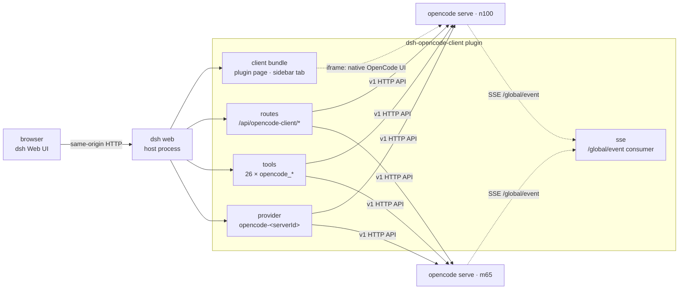

# dsh-opencode-client

<p align="center">
  <a href="https://github.com/yhuan416/dsh-opencode-client/releases"></a>
  <a href="LICENSE"></a>
  
  
  <a href="https://github.com/yhuan416/dsh-opencode-client/actions/workflows/check.yml"></a>
</p>

> 中文 | [English](README.md)

**把 OpenCode 注册为 dsh 的原生子代理后端，同时充当每台远端 `opencode serve` 的客户端。**
插件连接一台或多台远端 `opencode serve`，把它们的 projects / sessions / messages 通过工具与
HTTP 路由暴露给 dsh，把任务委派进去，并把每台 server 注册为 dsh 原生 subagent provider
（`opencode-<serverId>`）。

> **定位**：核心能力是把 OpenCode 注册为 dsh 的**原生 subagent 后端**
> （`opencode_subagent_<server>`），并把远端会话/工作区暴露为工具（`opencode_subagent`、
> `opencode_prompt`、shell/git/read/find、各类目录）。嵌入的 OpenCode Web UI 只是可选的完整
> 功能入口，不替代 OpenCode 客户端。

## 目录

- [快速开始](#快速开始) · [架构](#架构) · [功能](#功能)
- [安装](#安装) · [配置](#配置) · [Subagent 接缝](#subagent-接缝)
- [文档](#文档) · [生态](#生态) · [兼容性与版本](#兼容性与版本) · [说明与限制](#说明与限制)

## 快速开始

```sh
# 1. 把插件装进 web profile（bundle 选择在重启时组合）
dsh plugin --profile web add /path/to/dsh-opencode-client

# 2. 至少配置一台 server（完整字段见「配置」）
#    config.servers: [{ id: n100, url: "http://192.168.4.50:4096" }]

# 3. 重启 dsh web
dsh web
```

验证：

1. **设置 → 插件 → OpenCode Client** 出现服务器 / 工作区 / 会话区块
   （`GET /api/opencode-client/list` 能返回已配置的 servers）。
2. 让 agent 调用 **`opencode_sessions`** —— 能列出远端会话，说明到 `opencode serve` 的 HTTP
   链路端到端可用。
3. 可选：把该 server 暴露为原生 subagent（`opencode_subagent_<server>`）——见
   [Subagent 接缝](#subagent-接缝)。

前提：远端 OpenCode 需从 dsh 宿主可达；`opencode serve` 默认绑 `127.0.0.1`，网络访问需绑
`0.0.0.0` 或走 SSH 隧道，并建议设置 `OPENCODE_SERVER_PASSWORD`。

## 架构

OpenCode 的官方架构：`opencode serve` 暴露 OpenAPI HTTP 服务，"an opencode client can use"；
TUI / Web / SDK 都是它的客户端。本插件是另一个客户端，宿主在 dsh 里。



浏览器只与 **dsh 同源**通信 —— `lib/client.js` 渲染插件页和右侧栏标签页，并用 iframe 嵌入
OpenCode 原生 UI。`lib/routes.js`（`/api/opencode-client/*`）与面向模型的 `opencode_*` 工具
（`lib/tools.js`）发出确定性的 v1 HTTP 调用；`lib/provider.js`（`opencode-<serverId>`）和
`lib/session-run.js` 驱动委派运行；`lib/sse.js` 订阅每台 server 的 `/global/event`（带重连），
提供实时进度、idle 完成等待与权限/提问桥接。

更多：[ARCHITECTURE.md](ARCHITECTURE.md) · [docs/ARCHITECTURE.zh.md](docs/ARCHITECTURE.zh.md)。

## 功能

26 个面向模型的 `opencode_*` 工具、宿主 HTTP 路由，以及每台 server 一个原生 subagent provider。

### 子代理委派

- **原生子代理** — provider `opencode-<serverId>`，配合 `@deepseek-ai/dsh-tool-subagent` 可暴露
  一次性执行的 `opencode_subagent_<server>` 工具。
- **委派** — 工具 `opencode_subagent`（新建会话，或 `session=` 续用；可选 `agent`、`model` 与
  prompt 级 `schema`）；走 `prompt_async` + 消息轮询，失败回退阻塞式 prompt，返回最终答案和
  会话 id。
- **回合制续聊** — `opencode_prompt` 向已有远端会话发一条消息（默认 fire-and-forget，
  `wait=true` 则阻塞等本轮结束）；用 `opencode_messages`/`opencode_progress` 读回复，再发下一条。
  远端会话可跨 dsh 回合长期存活。
- **完成等待** — `prompt_async` + SSE `session.idle` 事件驱动（远端空闲立即返回），5s 轮询兜底，
  再回退到阻塞式 prompt 接口。
- **实时进度** — `opencode_progress`（当前工具/步骤、耗时、输出 tail），由 SSE 工具事件驱动；
  委派完成由 SSE idle 事件触发。
- **中止** — `opencode_abort` 停止远端运行中的会话；等待中的委派会返回 abort 错误而不是继续
  挂起。注意：同一轮次内 dsh 会串行执行工具调用，因此 abort 需从**另一个会话/agent** 发起，
  无法抢占同轮次里阻塞中的 `opencode_subagent`。
- **附件** — `opencode_subagent` 支持 `files` JSON 数组（text/base64 → data URL file part）。

### 会话与消息

- **服务配置** — `servers: [{ id, label?, url, password?, directory? }]`，可带每台 server 的默认
  `agent` 与 `model`。
- **发现** — `GET /api/opencode-client/list`（健康状态、projects、按目录分组的 sessions）。
- **会话列表** — 工具 `opencode_sessions` + `GET /api/opencode-client/sessions`。
- **会话消息** — 工具 `opencode_messages` + `GET /api/opencode-client/messages`（含 text / tool /
  file part）；可用来判断某会话是否值得续用。
- **会话信息** — 工具 `opencode_session_info`（title/summary/todos/diff）与 `opencode_share`
  （share/unshare 链接）。
- **会话管理** — `opencode_fork`、`opencode_children`、`opencode_summarize`（mutating）、
  `opencode_init`（写 AGENTS.md，需 `confirm=true`）。
- **会话搜索 / 诊断** — `opencode_search`（v2 会话搜索，v1 兜底）、`opencode_mcp`（MCP 服务状态）。
- **多 server** — 以数组配置，由客户端聚合（OpenCode 服务端没有联邦 API）。

### 目录与工具发现

- **Agent 目录** — 工具 `opencode_agents` + `GET /api/opencode-client/agents`（primary/subagent，
  native/custom）；委派前可用它挑 agent 名。
- **目录类** — `opencode_models`（provider/model，凭据已脱敏）、`opencode_commands`、
  `opencode_skills`、`opencode_tools`、`opencode_references`。
- **命令执行** — `opencode_command` 在会话内执行远端命令（如 `init`）并返回最终文本。

### 工作区与 git

- **工作区操作** — `opencode_shell`、`opencode_git_status`、`opencode_git_diff`、
  `opencode_read_file`、`opencode_find`（按路径或按文本内容搜索）。
- 这些都是确定性的直连调用（不经过远端模型）：核对远端 agent 改了什么、读文件、跑命令或搜索
  工作区。

### 权限与事件

- **权限审批** — `permission: ask`（默认）把远端权限请求转成 dsh 审批卡；`allow`/`reject`
  确定性应答。
- **提问桥接** — 工具发起的运行（有 agent 在作用域）会把远端提问转发到 dsh 用户提问 UI；
  否则自动拒绝。
- **实时** — 每台 server 常驻 SSE（`/global/event`），带重连；权限/提问快速应答、
  `GET /api/opencode-client/events`、`/status`、`live`/`running` 状态。
- **轮询兜底** — 委派运行期间权限/提问会被应答：SSE 事件立即处理，流不可用时有 15s 轮询兜底。

### UI

- **插件页** — 「OpenCode Client」分区：服务器/工作区/会话、会话 id、当前工具、查看消息、
  新建会话。
- **内嵌 OpenCode UI** — 注册右侧栏标签页（`kind: opencode`）：服务器选择 + 真实 OpenCode Web UI
  的 iframe，直接在当前会话页面右侧打开。入口：服务器行「侧边栏打开」或右侧栏「+」里选
  OpenCode；「全屏」浮层和「新标签」作为兜底。嵌入的是完整客户端（流式、工具卡片、diff、
  权限），无需重实现。
- **入口** — 同一内嵌 UI 也可从左侧栏面板列与会话头的「OpenCode」按钮打开。

## 安装

```sh
# 方式一：dsh 插件管理
dsh plugin --profile web add /path/to/dsh-opencode-client

# 方式二：脚本写入 profile（deps + bundles + 起始 server 行）
bash scripts/install-into-profile.sh http://192.168.4.50:4096 n100
```

手动方式（profile）：

```json
{
  "dependencies": { "dsh-opencode-client": "file:/path/to/dsh-opencode-client" },
  "dsh": { "profile": { "bundles": ["@deepseek-ai/dsh-base", "@deepseek-ai/dsh-web-app", "dsh-opencode-client"] } }
}
```

之后需重启 `dsh web`：bundle 选择在启动时组合。

## 配置

```yaml
- id: opencode-client
  name: dsh-opencode-client
  config:
    servers:
      - id: n100
        label: n100 opencode
        url: http://192.168.4.50:4096
        # apiVersion: auto       # auto（探测 /api/info）| 1 | 2
        # password: xxx          # OPENCODE_SERVER_PASSWORD（Basic，用户名 opencode）
        # directory: /home/yhuan/workspace   # 调用方未给目录时的默认远端目录
        # agent: plan            # 委派默认 agent
        # model: deepseek/deepseek-chat      # 默认模型 "provider/model"
      - id: m65
        label: 4.65 opencode
        url: http://192.168.4.65:4096
    permission: ask              # ask（默认，审批卡）| allow | reject
    question: reject             # reject（默认）| ignore
    pathMap:                     # 本地/远端路径布局不同时
      - { from: /home/yhuan, to: /home/yhuan }
```

### 注册为原生 subagent

```yaml
- insert:
    - id: tool-opencode-n100
      name: "@deepseek-ai/dsh-tool-subagent"
      config:
        provider: opencode-n100   # "opencode-" + server id
        maxDepth: provider-managed
        toolName: opencode_subagent_n100
```

## Subagent 接缝

原生 `opencode_subagent_<server>` 工具接入 dsh 的 `ctx.subagents` provider 接缝。
契约、能力映射与已应用的优化（父 agent 归属、事件驱动等待、幂等 dispose）见
[docs/subagent-seam.md](docs/subagent-seam.md)。`opencode_subagent` 与原生 provider 复用同一条
session 运行生命周期（`lib/session-run.js`）：同一套建会话、交互跟踪、异步 prompt + SSE idle
等待与中止逻辑。原生 subagent 会话标题为 `dsh subagent: <label>`，插件页可直接识别（页面现在也
显示会话 id 和运行中服务器的当前工具）。

## 文档

- [ARCHITECTURE.md](ARCHITECTURE.md) —— 模块地图、数据流、设计决策
- [docs/ARCHITECTURE.zh.md](docs/ARCHITECTURE.zh.md) —— 中文架构（与 ARCHITECTURE.md 对应）
- [docs/TOOLS.zh.md](docs/TOOLS.zh.md) —— 中文工具总览：26 个 `opencode_*` 工具、参数、只读/可变
- [COMPATIBILITY.md](COMPATIBILITY.md) —— dsh / OpenCode 兼容性与版本策略
- [docs/opencode-v2-migration.zh.md](docs/opencode-v2-migration.zh.md) —— OpenCode 2.3.0 实测兼容缺口与迁移计划（仅方案；尚未提供 v2 支持）
- [docs/subagent-seam.md](docs/subagent-seam.md) —— dsh subagent provider 接缝
- [docs/chat-ui-proposal.md](docs/chat-ui-proposal.md) —— 插件页远端会话聊天提案
- [README.md](README.md) · [TODO.md](TODO.md) · [CHANGELOG.md](CHANGELOG.md)

## 生态

| 项目 | 职责 |
|---|---|
| [dsh-remote-hub](https://github.com/yhuan416/dsh-remote-hub) | Hub 侧：一个 dsh Web UI 接管所有后端 —— 反向代理、托管 SSH 隧道、顶栏切换、远端 subagent provider。 |
| [dsh-remote-agent](https://github.com/yhuan416/dsh-remote-agent) | 远端侧：运行在每个后端 `dsh web` 里，发布本进程的启动 token + 身份，hub 无需手工拷贝 token。 |
| **dsh-opencode-client**（本仓库） | Sidecar：把远端 `opencode serve` 当作 dsh subagent 后端与客户端（会话、委派、目录），与 dsh remotes 相互独立。 |

## 兼容性与版本

见 [COMPATIBILITY.md](COMPATIBILITY.md)。插件采用独立语义化版本，已验证 dsh `0.2.1-rc.2` 与
OpenCode `1.18.10/1.18.31/1.18.33`；暂不发布 npm（从 git 或本地路径安装）。OpenCode 2 在传输层
可被探测（`apiVersion: auto`），其余 v2 API 尚未迁移——见
[docs/opencode-v2-migration.zh.md](docs/opencode-v2-migration.zh.md)。

## 说明与限制

- 远端 OpenCode 需从 dsh 宿主可达；`opencode serve` 默认绑 `127.0.0.1`，网络访问需绑
  `0.0.0.0` 或走 SSH 隧道；建议设置 `OPENCODE_SERVER_PASSWORD`。
- 会话续用通过 OpenCode HTTP API；原生外部子代理仍是一次性执行（与 Codex/Claude Code 后端一致）。
- 远端 agent 的交互式提问，在运行由 `opencode_subagent` 发起（有 agent 在作用域）时转发到 dsh
  用户提问 UI；否则自动拒绝。
- **结构化输出是 prompt 约束而非 `format=` 强约束**：opencode 1.18.x 使用
  `format: {type:"json_schema"}` 后会把 `retryCount` 持久化，导致 `GET /session/{id}/message`
  返回 400，会话不可读。插件因此不发送 `format`，而是追加"只返回 JSON"指令并本地校验（`schema`）。
- 权限卡需要**工具发起的委派**（有 live agent）；HTTP 直接调用回落 allow/reject。
- 多 server 由客户端聚合（OpenCode 服务端没有联邦 API）。
- 委派运行期间权限/提问会被应答：SSE 事件立即处理，流不可用时有 15s 轮询兜底。
- 插件页显示 `live`（SSE 已连接）与当前运行中的会话数。
- **v1 HTTP API 为基线**；仅当 v1 缺能力时才用 v2（`/api/*`，如会话搜索、兜底）——见
  [TODO.md](TODO.md) 与 [COMPATIBILITY.md](COMPATIBILITY.md)。
